# 01 — System Architecture

This chapter defines the shape of the system: its architectural style, its containers and modules (C4), how data flows end-to-end, the cross-cutting concerns, and the deployment/scaling/cost/security strategy. It closes with the repository layout, the module dependency rules, and a technology-choice ledger with tradeoffs.

## 1. Architectural style

PokéQuant is a **modular monolith** at the application core, surrounded by a **separate async worker fleet**, a **data/orchestration plane**, and an **ML plane**. Within the core we apply **hexagonal (ports-and-adapters) architecture**: domain logic depends only on interfaces (ports); databases, external APIs, caches, and model registries are outbound adapters.

Why this shape (full reasoning in [ADR-0002](adr/0002-modular-monolith-over-microservices.md)):

- A solo/small-team, pre-traffic system does not have the organizational or scale pressures that justify microservices. Distributed systems add network hops, partial-failure modes, deployment complexity, and data-consistency headaches that would dominate the effort.
- A modular monolith with **strict bounded-context boundaries** gets 90% of the modularity benefit (independent reasoning, testability, clear ownership) with 10% of the operational cost.
- We still physically separate the three workloads that genuinely have different scaling and failure profiles: **synchronous API**, **async/scheduled jobs**, and **ML training/inference**. That is the natural first seam.

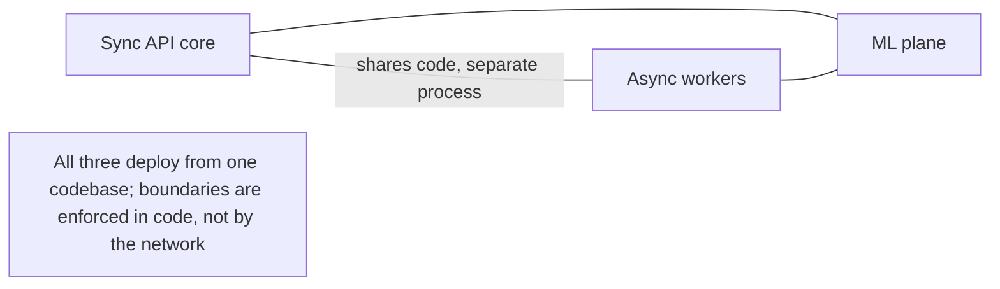

## 2. C4 Level 1 — System context

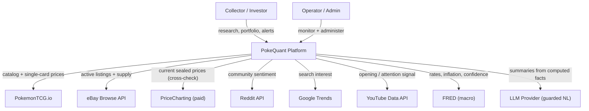

The platform is the trusted core; all external sources are untrusted, rate-limited, and individually failure-prone (see [02 — Data Sources](02-data-sources.md)). The LLM is used **only** to phrase facts the platform already computed ([ADR-0007](adr/0007-explainability-first-class.md)).

## 3. C4 Level 2 — Container view

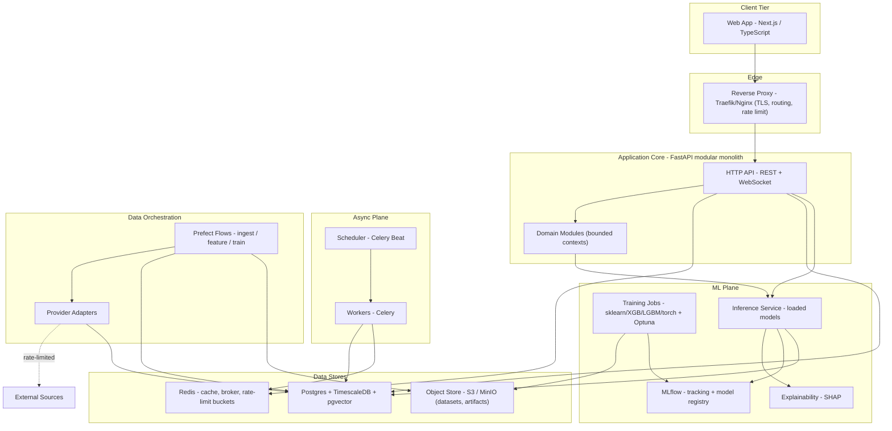

Containers and their responsibilities:

- **Web App** — server-rendered dashboards + interactive charts; talks only to the API.
- **Reverse proxy** — TLS termination, routing, coarse rate limiting, and a single public ingress.
- **API core** — synchronous request/response + WebSocket streams; orchestrates domain modules; owns auth. Deliberately **stateless** (horizontally scalable).
- **Async plane** — Celery workers execute API-triggered background jobs (e.g., "recompute portfolio," "backfill instrument"); Celery Beat triggers cron-like tasks.
- **Data orchestration** — Prefect runs the multi-step, retry-heavy, observable pipelines (ingestion, feature builds, training). Provider adapters are the only code that touches external APIs.
- **ML plane** — training jobs produce versioned models registered in MLflow; the inference service loads registered models and serves point + interval predictions; SHAP produces attributions.
- **Data stores** — Postgres/TimescaleDB/pgvector is the system of record ([ADR-0003](adr/0003-postgres-timescaledb-primary-store.md)); Redis is cache + broker; object storage holds training datasets and model artifacts.

## 4. C4 Level 3 — Core component view (bounded contexts)

The core is partitioned into bounded contexts. Each is a Python package with its own `domain`, `application`, and `adapters` layers and a public interface other modules call. Modules never reach into each other's tables.

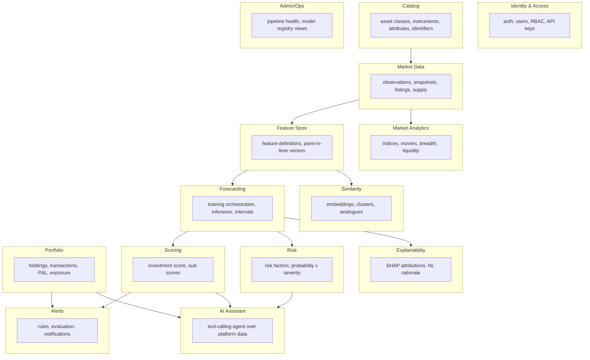

**Dependency rule (hexagonal):** dependencies point *inward* — inbound adapters (REST controllers, CLI) → application services → domain. Outbound adapters (repositories, provider clients, cache, registry client) implement domain-declared **ports**. The domain layer imports nothing from frameworks. This is what makes the code testable (swap adapters for fakes) and portable (extract a module into a service without touching its domain).

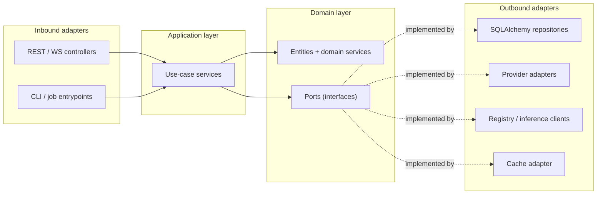

## 5. Target microservice decomposition (when we outgrow the monolith)

We do not build these now, but we design the seams so extraction is mechanical. Extract a service only when a real signal appears (independent scaling need, isolation for reliability/security, or team ownership).

| Candidate service | Extract when | Natural seam |
|-------------------|--------------|--------------|
| **Ingestion / provider workers** | External volume or rate-limit orchestration dominates | Already a separate process; talks to DB via repository ports |
| **Inference service** | GPU/CPU profile diverges from API, or QPS needs independent scaling | Already isolated behind an `InferencePort` |
| **Feature/training pipeline** | Training resource needs or schedule isolation | Already a Prefect deployment |
| **AI assistant** | LLM cost/latency isolation, independent rate limits | Behind an `AssistantPort`; stateless |
| **Notifications** | Fan-out volume (email/push/webhooks) | Behind an `AlertDispatchPort` |

Because every cross-module call already goes through a typed port, "extract to service" means "swap the in-process adapter for an HTTP/gRPC adapter" — no domain changes.

## 6. End-to-end data flow

```mermaid
flowchart LR
    ingest["Ingest (provider adapters)"] --> raw["Raw observations (append-only)"]
    raw --> norm["Normalize: currency, condition, dedupe, outlier flag"]
    norm --> snap["Daily snapshots (Timescale hypertable)"]
    snap --> feat["Point-in-time feature build"]
    feat --> fstore["Feature store"]
    fstore --> train["Train + walk-forward validate"]
    train --> reg["Versioned model registry"]
    reg --> infer["Batch (nightly) + online inference"]
    infer --> preds["Predictions + intervals (persisted)"]
    preds --> xai["SHAP attributions + NL rationale"]
    xai --> sr["Investment score + risk assessment"]
    sr --> serve["API / UI / alerts / assistant"]
```

Two invariants make this trustworthy:

1. **Append-only raw + point-in-time features.** We never overwrite history; features are computed *as of* a timestamp using only data available then. This is the single most important defense against look-ahead leakage ([04](04-feature-engineering.md), [05](05-machine-learning.md)).
2. **Everything downstream of `preds` is reproducible.** A prediction row references the exact model version and feature-set version that produced it, so any score/explanation can be regenerated.

## 7. Key sequences

### 7.1 Daily ingestion (scheduled)

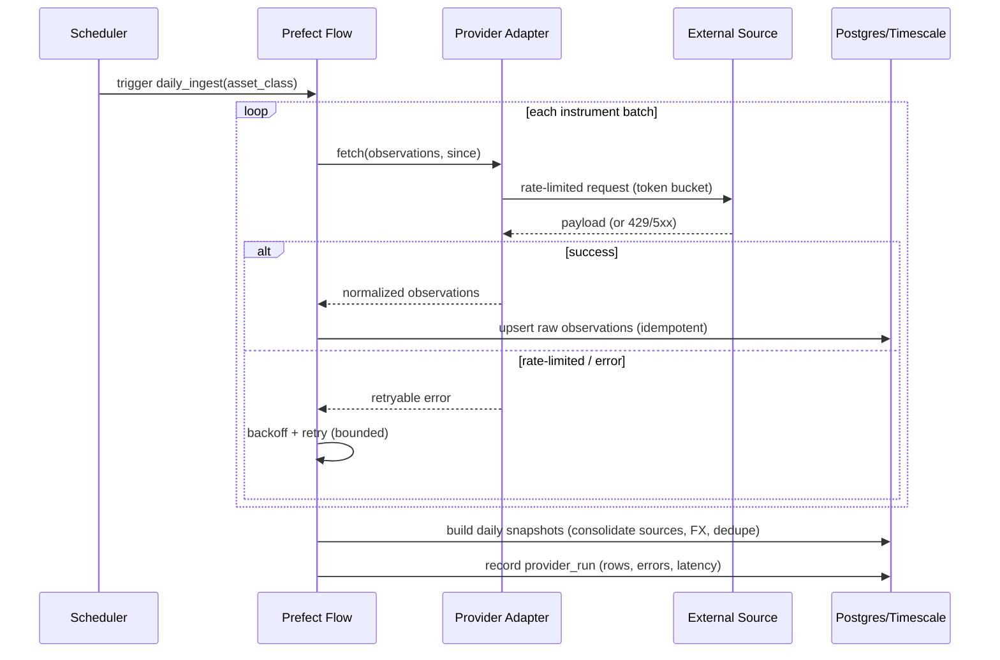

### 7.2 Nightly training & promotion

```mermaid
sequenceDiagram
    participant Beat as Scheduler
    participant Flow as Training Flow
    participant FS as Feature Store
    participant Obj as Object Store
    participant Reg as MLflow Registry
    Beat->>Flow: trigger retrain(asset_class, horizon)
    Flow->>FS: assemble point-in-time training frame
    Flow->>Obj: snapshot dataset (versioned parquet)
    Flow->>Flow: walk-forward CV + Optuna HPO
    Flow->>Reg: log runs, metrics, params, artifacts
    alt candidate beats champion on holdout + calibration gates
        Flow->>Reg: register new version, stage = Staging
        Flow->>Flow: shadow-evaluate vs champion
        Flow->>Reg: promote to Production
    else fails gates
        Flow->>Reg: keep champion; flag for review
    end
```

### 7.3 Prediction request (online, cached)

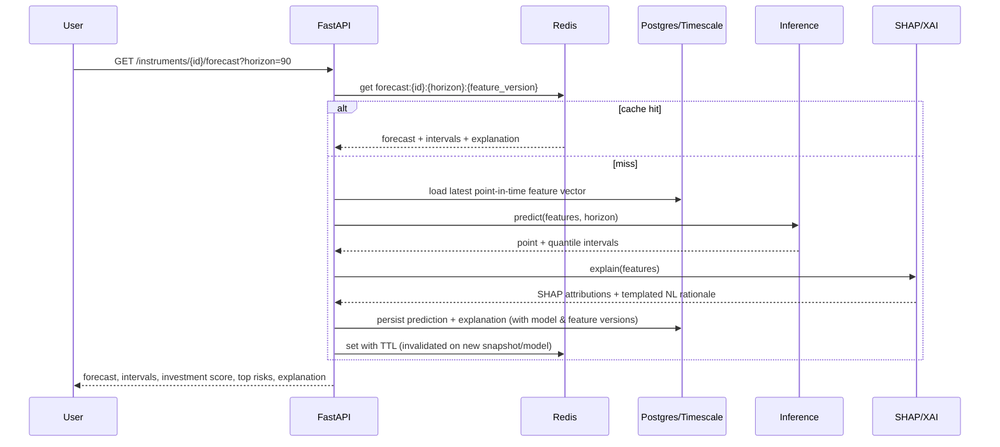

### 7.4 Alert evaluation

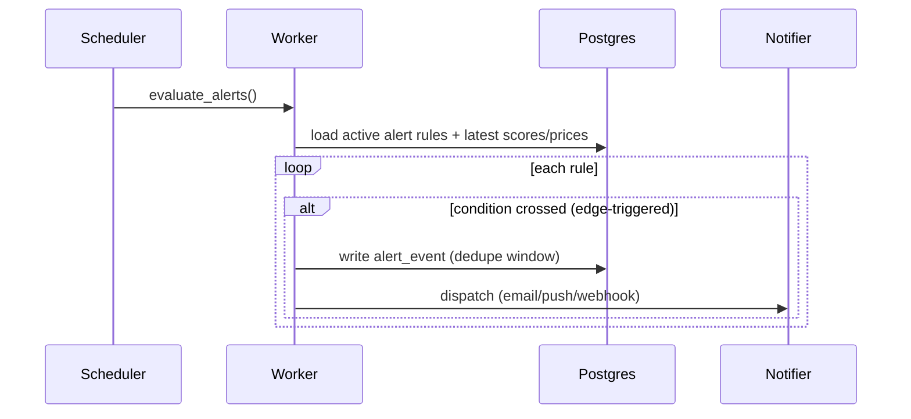

## 8. Cross-cutting concerns

- **Authentication & authorization.** OAuth2 password grant + JWT (short-lived access, rotating refresh), Argon2id password hashing, RBAC (roles: `user`, `pro`, `admin`) enforced by FastAPI dependencies at the controller boundary; per-user API keys for programmatic access ([ADR-0008](adr/0008-python-fastapi-backend.md), details in [13](13-engineering-standards.md)).
- **API gateway.** The reverse proxy provides TLS, routing, and coarse per-IP rate limits; fine-grained per-user/endpoint quotas are enforced in-app via Redis token buckets. A managed gateway (Kong/API Gateway) is a later option if we split services.
- **Caching.** Redis with explicit TTLs and event-based invalidation: forecasts/scores keyed by `(instrument, horizon, feature_version, model_version)`; expensive analytics cached and refreshed on snapshot completion; HTTP caching headers for public catalog reads.
- **Background workers.** Celery for API-triggered/ad-hoc jobs; Prefect for scheduled data/ML pipelines. (Two tools because their jobs differ: Celery = short, user-facing, high-volume; Prefect = long, observable, retry-heavy DAGs.)
- **Error handling.** Typed domain exceptions → mapped to RFC 9457 `problem+json` responses; providers use bounded retries with exponential backoff + jitter and circuit breakers; pipelines are idempotent so a failed run can be safely re-run.
- **Configuration.** 12-factor: all config via environment, parsed and validated by Pydantic Settings; no config in code; per-environment overlays.
- **Secrets management.** Never in the repo; local `.env` (git-ignored) → SOPS-encrypted files or a managed secret store (AWS Secrets Manager/Doppler) in deployed environments; secrets injected at runtime.
- **Logging.** Structured JSON via `structlog`, one event per log line, correlation/request IDs propagated across API → worker → pipeline.
- **Monitoring & tracing.** OpenTelemetry SDK → Prometheus (RED/USE metrics) + Grafana dashboards + Loki (logs) + Tempo/Jaeger (traces); Sentry for exceptions; domain metrics (ingest rows, provider error rate, model staleness, prediction latency, calibration drift).
- **Rate-limit orchestration.** Every provider has a declared budget (see [02](02-data-sources.md)); a shared Redis token-bucket enforces it across all workers so we never exceed a source's limit regardless of concurrency.

## 9. Scalability strategy

- **Stateless API** scales horizontally behind the proxy; sessions live in JWT/Redis, not in process memory.
- **TimescaleDB** handles time-series scale via hypertable partitioning (chunk by time), continuous aggregates for daily/weekly rollups, compression of old chunks, and retention policies for raw observations.
- **Read scaling** via Postgres read replicas for analytics/heavy reads; the write path (ingestion) stays on primary.
- **Workers scale by queue**: separate Celery queues (ingest, features, inference, notify) scale independently; Prefect work-pools size to workload.
- **Caching absorbs read spikes**; forecasts/scores are recomputed on data change, not per request.
- **Inference scales independently** of the API and can be GPU-backed if deep models dominate.
- **Bottleneck honesty:** the true ceiling is *external* rate limits, not our compute. The design treats data acquisition as the scarce resource and optimizes around it (own-your-timeseries + caching + synthetic augmentation).

## 10. Deployment strategy (two tracks)

Documented side-by-side so the cost/complexity tradeoff is explicit ([12 — Roadmap](12-roadmap.md) sequences them).

**Track A — Cost-optimized (portfolio / MVP → early prod):**

- Containers on a single small VM or a PaaS (Fly.io / Render / Railway).
- Managed Postgres with the Timescale extension (Timescale Cloud / Neon-style) — no DB ops.
- Managed Redis (Upstash) with per-request pricing.
- Object storage on Cloudflare R2 / S3 (cheap egress).
- One `docker-compose` for local; a slim IaC for the PaaS.
- Roughly a few tens of dollars/month; scales to thousands of users with caching.

**Track B — Enterprise / scale:**

- Kubernetes (EKS/GKE) with Helm charts per workload; HPA on API and workers.
- RDS/Cloud SQL Postgres + read replicas; ElastiCache Redis; S3 + CloudFront.
- Terraform for all infrastructure; blue/green or canary deploys.
- Full observability stack (Prometheus/Grafana/Loki/Tempo) and autoscaling.

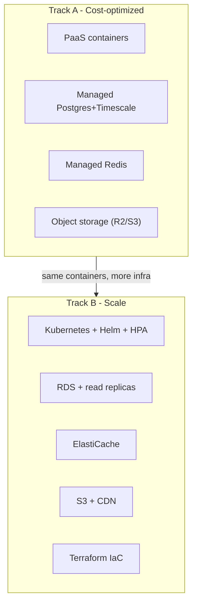

## 11. Cost optimization

- **Cache aggressively; compute on change.** Forecasts/scores/analytics are recomputed when a snapshot or model changes, then served from cache — bounding LLM and inference spend.
- **Right-size cadence.** Sealed prices move on daily-or-slower timescales, so daily batch beats real-time streaming; no need to pay for streaming infra.
- **Compress and expire.** Timescale compression on old chunks; retention on high-volume raw observations after they are rolled into snapshots.
- **LLM discipline.** The assistant uses small models for routing and reserves large models for synthesis; responses are cached; explanations are templated first, LLM-polished second ([ADR-0007](adr/0007-explainability-first-class.md)).
- **Spot/preemptible for training.** Nightly training is restart-safe (checkpointed, idempotent), so it can use cheap interruptible compute.
- **Scale to zero** for the assistant and inference in Track A when idle.

## 12. Security

- **AuthN/Z:** short-lived JWTs, rotating refresh tokens, Argon2id hashing, RBAC at the boundary, per-key scopes and rate limits.
- **Transport & storage:** TLS everywhere; encryption at rest for DB and object storage; PII minimized (we store little beyond account + portfolio).
- **Input handling:** Pydantic validation on every boundary; parameterized queries via SQLAlchemy (no string SQL); output encoding in the UI; strict CORS.
- **Secrets:** never in repo/images; injected at runtime; rotated; least-privilege credentials per provider.
- **Supply chain:** pinned dependencies, lockfiles, `pip-audit`/`npm audit` and image scanning in CI, SBOM generation.
- **Abuse & scraping resilience:** per-user quotas; the platform is a good API citizen to upstreams (respects `robots.txt`/ToS, backs off on 429).
- **Auditability:** an append-only `audit_log` records privileged actions and admin operations.

## 13. Repository structure (monorepo)

A single monorepo keeps the shared domain contracts, generated API types, and cross-cutting tooling in one place; `uv` (Python) and `pnpm` (JS) manage the two ecosystems ([ADR-0008](adr/0008-python-fastapi-backend.md), [ADR-0009](adr/0009-nextjs-typescript-frontend.md)).

```text
pokequant/
  README.md
  docs/                      # this specification
  apps/
    api/                     # FastAPI core (modular monolith)
      pokequant/
        core/                # config, logging, di container, errors
        modules/             # one package per bounded context
          identity/
            domain/          # entities, value objects, ports
            application/     # use-case services
            adapters/        # controllers (in), repositories (out)
          catalog/
          market_data/
          features/
          forecasting/
          scoring/
          risk/
          explainability/
          similarity/
          portfolio/
          alerts/
          analytics/
          assistant/
          admin/
        main.py              # app assembly, router wiring, DI
      tests/
      pyproject.toml
    web/                     # Next.js app
      app/                   # routes (App Router)
      components/
      lib/                   # api client (typed), hooks
      tests/
      package.json
    workers/                 # Celery app + task modules (imports api domain)
    pipelines/               # Prefect flows: ingest, features, train
    inference/               # model-serving service (imports forecasting domain)
  packages/
    asset-plugins/
      pokemon-sealed/        # the first asset-class plugin
      # mtg-sealed/          # future
    shared-py/               # cross-cutting python (schemas, ta, utils)
    shared-ts/               # generated API types, ui primitives
  infra/
    docker/                  # Dockerfiles, compose
    k8s/                     # Helm charts (Track B)
    terraform/               # IaC (Track B)
  ml/
    training/                # training entrypoints, model definitions
    evaluation/              # walk-forward, metrics, calibration
    registry/                # MLflow config
  data/
    synthetic/               # calibrated historical generator
    seeds/                   # asset-class seed catalogs
  .github/workflows/         # CI/CD
```

## 14. Module dependency graph & rules

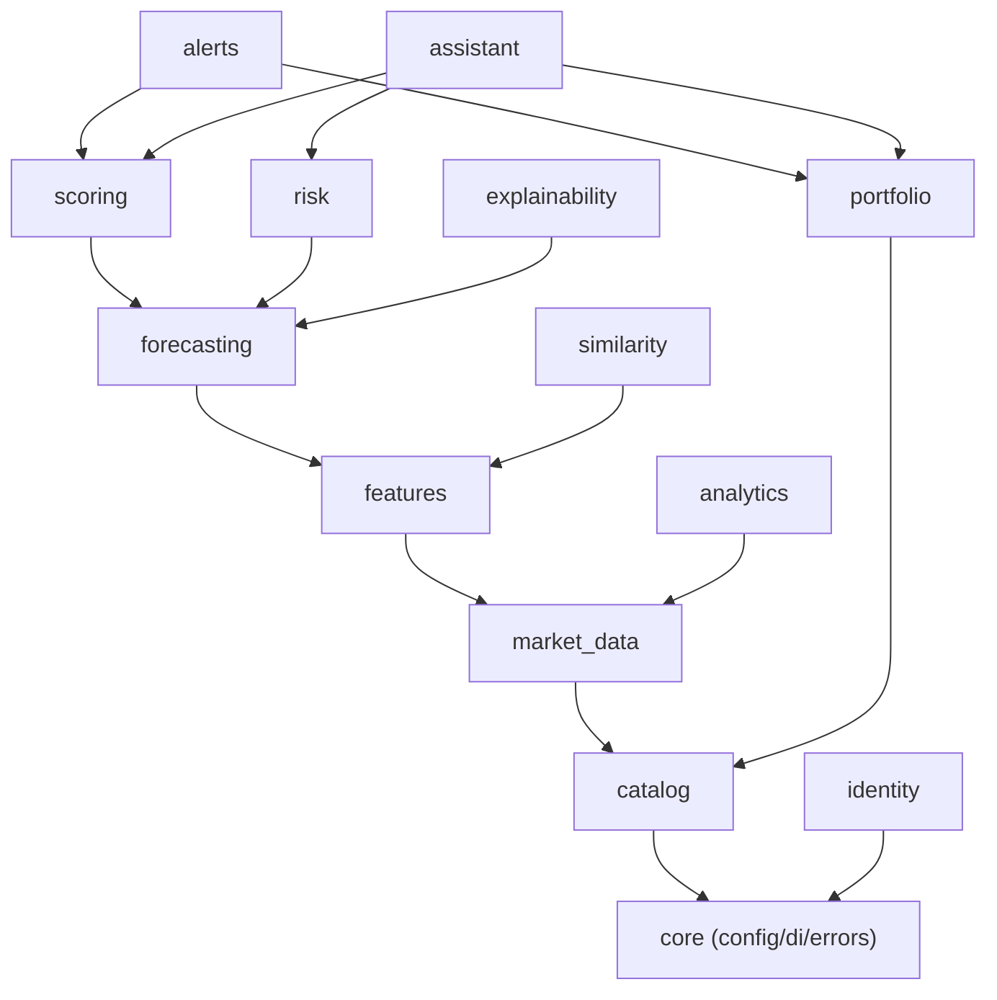

Rules enforced in code review (and later by an import-linter):

1. Dependencies flow one way (upstream contexts never import downstream ones).
2. A module exposes a **public interface** (`application` services + DTOs); other modules import only that, never another module's `domain` internals or its tables.
3. The `domain` layer imports no framework code (no FastAPI, no SQLAlchemy).
4. Asset-class specifics live only in `packages/asset-plugins/*`, behind the provider/attribute/feature ports.

## 15. Technology choices and tradeoffs

| Area | Choice | Primary rationale | Alternatives (why not) |
|------|--------|-------------------|------------------------|
| Backend language | **Python 3.12** | Unifies API + data + ML in one language; best-in-class ML ecosystem | Go/Node (great APIs, weak ML); Java (heavy). Split-language adds a serialization boundary we don't need yet |
| API framework | **FastAPI** | Async, Pydantic v2 typing, auto OpenAPI, DI via `Depends` | Django (batteries but heavier, sync-first); Flask (less typing/async). See [ADR-0008](adr/0008-python-fastapi-backend.md) |
| ORM/migrations | **SQLAlchemy 2.0 + Alembic** | Typed, mature, supports the raw SQL we need for Timescale | Django ORM (couples to Django); Tortoise (younger) |
| Datastore | **Postgres + TimescaleDB + pgvector** | One engine for relational + time-series + vectors | Separate TSDB (Influx) + vector DB adds ops. See [ADR-0003](adr/0003-postgres-timescaledb-primary-store.md) |
| Cache/broker | **Redis** | Cache + Celery broker + rate-limit buckets in one | Memcached (no broker); RabbitMQ (broker only) |
| Async jobs | **Celery** | Mature, battle-tested for user-facing background work | RQ (simpler, fewer features); Dramatiq/Arq (younger) |
| Pipelines | **Prefect** | Pythonic DAGs, retries, observability; lighter than Airflow | Airflow (heavy ops); Dagster (great, heavier concepts) |
| ML — tabular | **XGBoost/LightGBM/CatBoost** | State of the art on tabular; fast; SHAP-friendly | Deep nets rarely beat GBMs on small tabular data |
| ML — temporal | **PyTorch + darts (LSTM/TFT)** | Sequence models + native quantile forecasting | TF/Keras (fine; team prefers torch) |
| Baselines/stats | **scikit-learn, statsmodels, Prophet** | Honest baselines + interpretable trend/seasonality | — |
| HPO | **Optuna** | Efficient, pruning, define-by-run | Hyperopt/Ray Tune (heavier) |
| Experiment/registry | **MLflow** | Tracking + model registry + staging lifecycle | W&B (SaaS-first); DVC (data-centric) |
| Explainability | **SHAP** | Additive, local+global attributions; industry standard | LIME (less stable); native importances (coarser). See [ADR-0007](adr/0007-explainability-first-class.md) |
| Frontend | **Next.js + TS + Tailwind + shadcn/ui** | SSR/ISR, typed, fast to build, recruiter-familiar | SvelteKit/Remix (smaller ecosystems). See [ADR-0009](adr/0009-nextjs-typescript-frontend.md) |
| Charts | **TradingView lightweight-charts + visx/Recharts** | Financial-grade price charts + flexible analytics | Chart.js/Highcharts (less finance-native / licensing) |
| Observability | **OpenTelemetry + Prometheus/Grafana/Loki/Tempo + Sentry** | Open standard, portable, no lock-in | Datadog/New Relic (cost) |
| IaC / deploy | **Docker, Helm, Terraform, GitHub Actions** | Portable, industry standard | Pulumi/CDK (fine alternatives) |

## 16. Related decisions

- [ADR-0002 — Modular monolith over microservices](adr/0002-modular-monolith-over-microservices.md)
- [ADR-0003 — Postgres + TimescaleDB as primary store](adr/0003-postgres-timescaledb-primary-store.md)
- [ADR-0004 — Generic asset model + plugin registry](adr/0004-generic-asset-model-and-plugin-registry.md)
- [ADR-0006 — Typed provider adapter interface](adr/0006-provider-plugin-interface.md)
- [ADR-0008 — Python + FastAPI backend](adr/0008-python-fastapi-backend.md)
- [ADR-0009 — Next.js + TypeScript frontend](adr/0009-nextjs-typescript-frontend.md)

Continue to [02 — Data Sources](02-data-sources.md).
