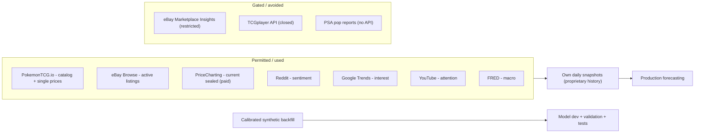

# 02 — Data Sources

Data is the hardest part of this problem, and being honest about it is what separates a credible platform from a demo. This chapter documents every source we use, the *real* (2026) access model, rate limits, legal/ToS constraints, expected schema, normalization, reliability, cadence, and failure modes — then explains the two strategies that make the platform work despite the constraints: **own-your-timeseries collection** and a **calibrated synthetic backfill** ([ADR-0005](adr/0005-synthetic-historical-backfill.md)).

All external access goes through typed **provider adapters** ([ADR-0006](adr/0006-provider-plugin-interface.md)); nothing else in the system makes a network call to a third party.

## 1. The core problem: historical sealed-price data is scarce and gated

This single fact drives the entire data design:

- **eBay's sold-listing history** (the gold standard for "what did it actually sell for") is exposed via the **Marketplace Insights API**, which is a *Limited Release* — **restricted and not open to new users**; access requires eBay Partner Network approval, signed contracts, and an Application Growth Check. We therefore **do not** rely on eBay sold data.
- **TCGplayer's API** has been **effectively closed to new developers** since the eBay acquisition; plan as if a key is unobtainable.
- **PriceCharting's** official API is **paid** and returns **current prices only** — *no history* via the official API or CSV.
- **PokemonTCG.io** is free and clean, but its embedded prices are for **single cards**, not sealed products.
- **PSA population reports** have **no official API** (cert-verification only); scraping risks ToS violation.

Conclusion: there is no free, legal, historical time series for sealed-product prices. So we **build our own** by snapshotting permitted sources daily going forward (a genuine data moat), and we **bootstrap/validate** the ML and application pipeline on a **calibrated synthetic history** until real history accumulates.

## 2. Normalized target schemas

Every adapter maps its source into one of these domain objects (fields simplified; full DB in [03](03-database-design.md)):

- **`PriceObservation`** — `instrument_id, source, observed_at, price, currency, price_usd, condition, kind {sold|listing|guide}, sample_size, url, raw_ref`
- **`SupplySnapshot`** — `instrument_id, source, observed_at, active_listings, min_ask, median_ask, depth_buckets`
- **`SentimentSignal`** — `instrument_id|query, source, window_start, window_end, mentions, sentiment_mean, sentiment_std, engagement`
- **`InterestSeries`** — `term, geo, granularity, points[(ts, value)]` (search interest)
- **`PopulationReport`** — `instrument_id|set, grade_counts{1..10}, total, as_of` (optional/best-effort)
- **`MacroSeries`** — `code, points[(ts, value)], units, frequency`

Normalization responsibilities at the adapter boundary: **currency → USD** (via a daily FX table), **condition mapping** (sealed vs. graded vs. used), **instrument resolution** (map a source's product/ID/title to our `instrument_id`), **dedupe** (same underlying sale/listing seen in multiple pulls), and **outlier flagging** (robust MAD-based z-score; do not delete, just flag).

## 3. Reliability tiers

We classify sources so the pipeline and models can weight them and degrade gracefully.

- **Tier 1 — Authoritative, stable API:** PokemonTCG.io (catalog/metadata), FRED (macro). Trusted; failures are rare and loud.
- **Tier 2 — Stable but partial / paid / legally-scoped:** eBay Browse (active only), PriceCharting (current only, paid), YouTube, Reddit. Trusted within their scope.
- **Tier 3 — Fragile / best-effort:** Google Trends (official alpha if granted, else pytrends), PSA population (manual/third-party). Never a hard dependency; features derived from them are optional and models must tolerate their absence.

---

## 4. Source-by-source

### 4.1 PokemonTCG.io — PRIMARY catalog (Tier 1, free)

- **What it provides:** authoritative Pokémon TCG **catalog** — sets (with `releaseDate`, series, total counts, symbols) and cards (name, number, rarity, subtypes, images) plus **embedded single-card prices** from TCGplayer (`tcgplayer.prices`) and Cardmarket (`cardmarket.prices`).
- **Role in PokéQuant:** the backbone of the **instrument catalog and lifecycle metadata** (release dates → "months since release," set/series attributes, reprint lineage). Single-card prices feed a **"chase-card / expected-value" feature** for sealed products (a booster box's value is partly a function of its hittable singles). It is **not** a sealed-product price source.
- **Access / method:** REST, base `https://api.pokemontcg.io/v2`; `X-Api-Key` header; free key from the developer portal. Pagination via `page`/`pageSize` (**max 250**). Official SDKs exist (Python/Ruby).
- **Rate limits:** **20,000 requests/day** with a key; **1,000/day and 30/min** without. HTTP 429 on breach → exponential backoff.
- **Legal / ToS:** free for third-party use; not affiliated with Nintendo/TPC (we mirror that disclaimer). Keep the key server-side.
- **Expected schema (abridged):** `set{id, name, series, releaseDate, printedTotal, total}`; `card{id, name, number, rarity, set, tcgplayer{url, updatedAt, prices{normal, holofoil, ...{low, mid, high, market, directLow}}}, cardmarket{prices{averageSellPrice, trendPrice, ...}}}`.
- **Normalization:** map `set` → our `set` attribute; resolve cards to instruments only for single-card asset classes (Phase 5+); for sealed, aggregate card prices per set into EV features.
- **Reliability:** Tier 1. Community-run but stable and widely used; prices update on a lag (updatedAt provided).
- **Cadence:** catalog refreshed on set releases (event-driven + weekly sweep); card prices daily.
- **Failure modes / problems:** price freshness lag; sealed products absent; occasional set-metadata gaps → handled by our own instrument seed catalog overlay.

### 4.2 eBay Browse API — active listings & supply (Tier 2, self-serve)

- **What it provides:** **active** marketplace listings — asking prices, conditions, item counts, seller/loc — via `GET /buy/browse/v1/item_summary/search`. This is our primary **supply/liquidity** signal (how many are for sale, at what asks).
- **Role:** `SupplySnapshot` (active listing count, min/median ask, depth) and asking-price `PriceObservation`s (`kind = listing`). Combined over time, these produce supply-growth/decline, days-on-market proxies, and liquidity features ([04](04-feature-engineering.md)).
- **Access / method:** eBay Developer Program app; OAuth2 **client-credentials** application token for Browse; self-serve (no partner approval needed for Browse). Search by query/category/filters; paginate.
- **Rate limits:** Browse API application-level default on the order of **~5,000 calls/day** (increases requestable via the developer questionnaire); we budget conservatively and cache.
- **Legal / ToS:** eBay Developer Program agreement + API License Agreement; must respect usage terms and display requirements; affiliate (EPN) needed only for feeds/monetization. Critically: **Marketplace Insights (sold history) is restricted and not used.**
- **Expected schema (abridged):** `itemSummaries[]{itemId, title, price{value, currency}, condition, conditionId, itemWebUrl, seller, itemLocation, buyingOptions}`, `total`, `next`.
- **Normalization:** filter to sealed condition and the specific product (title + category + our instrument matcher, with a manual alias table for tricky names); currency→USD; compute supply aggregates; flag outliers/mislisted items.
- **Reliability:** Tier 2 (authoritative for *active* listings; says nothing about *sold*).
- **Cadence:** daily supply snapshot per tracked instrument.
- **Failure modes:** listing spam / mislabeled items (mitigated by matcher + outlier flagging); active asks overstate realized prices (we treat asks and sales distinctly and never conflate them); rate-limit ceilings (mitigated by token bucket + prioritizing tracked instruments).

### 4.3 PriceCharting — current sealed prices (Tier 2, paid, optional)

- **What it provides:** consolidated **current** prices per condition, including a **"New & Sealed"** condition (condition id 2), for a broad product universe. A useful **independent cross-check** of our own consolidated sealed price and a cold-start value for newly tracked instruments.
- **Role:** a `PriceObservation` (`kind = guide`) for sealed condition, and a validation reference against our eBay-derived consolidated price. **No history** is available, so it contributes to *forward* snapshots only.
- **Access / method:** REST under `https://www.pricecharting.com/api/...`; 40-char **token** as the `t` query param; requires a **paid subscription** (Legendary tier) for API/CSV access.
- **Rate limits:** per subscription terms (not publicly enumerated); we cache and pull once/day.
- **Legal / ToS:** paid, licensed to the subscriber; redistribution restricted → we store it for internal features/validation, not resale.
- **Expected schema:** `product{id, product-name, console-name, ...prices by condition}`; sealed value under the "new" price key.
- **Normalization:** map PriceCharting product → instrument (UPC where available); condition id 2 → sealed; currency USD.
- **Reliability:** Tier 2 (stable, but current-only and paid).
- **Cadence:** daily.
- **Failure modes:** cost; coverage gaps for niche products; no history (by design we only use it forward).

### 4.4 Reddit API — community sentiment (Tier 2, free non-commercial)

- **What it provides:** posts/comments from relevant subreddits (r/PokemonTCG, r/PokeInvesting, etc.) → mentions, engagement (score/comments), and text for sentiment scoring.
- **Role:** `SentimentSignal` per instrument/keyword → sentiment level/momentum and "attention" features.
- **Access / method:** OAuth2 (script app); **PRAW** handles auth, pagination, and rate limiting.
- **Rate limits:** **100 QPM per OAuth client** (averaged over a 10-min window; bursting allowed), 10 QPM unauthenticated. Watch `X-Ratelimit-*` headers.
- **Legal / ToS:** free tier is **non-commercial** only; commercial use requires a paid agreement (~$0.24/1k calls, contract-gated). As a portfolio/research project we stay within non-commercial use and document it; going commercial would require the paid tier.
- **Expected schema:** `submission{id, title, selftext, created_utc, score, num_comments, subreddit}`, `comment{id, body, created_utc, score}`.
- **Normalization:** keyword→instrument mapping; language/spam filtering; sentiment via a finance/social model (VADER baseline → a transformer classifier), aggregated per instrument per window with volume.
- **Reliability:** Tier 2.
- **Cadence:** daily pull of recent windows; sentiment recomputed daily.
- **Failure modes:** sarcasm/hype noise (mitigated by volume-weighting and momentum rather than absolute level); the non-commercial boundary (documented); subreddit drift.

### 4.5 Google Trends — search interest (Tier 3, fragile)

- **What it provides:** relative **search interest** over time for terms (product/set names) — an early demand signal that often leads price.
- **Role:** `InterestSeries` → search-interest level, momentum, and breakouts ([04](04-feature-engineering.md)).
- **Access / method (two backends behind one `TrendsProvider`):**
  1. **Official Google Trends API (alpha)** — `https://trends.googleapis.com/v1alpha/trends:query`, GCP OAuth scope `https://www.googleapis.com/auth/trends.readonly`, **5-year rolling window**, consistently-scaled data, daily/weekly/monthly/yearly. **Invite-only alpha** (apply for access).
  2. **pytrends fallback** — unofficial; scrapes the Trends site; fragile and rate-limited (manual sleeps, frequent breakage).
- **Rate limits:** official — alpha quotas (tight); pytrends — undocumented, expect 429s; we throttle hard and cache.
- **Legal / ToS:** official API governed by Google API terms (clean); pytrends is unofficial and brittle → clearly marked Tier 3 and never a hard dependency.
- **Expected schema:** time series of `(date, value)` per term/geo; comparison across terms (official API removes the 0–100 per-request rescaling headache).
- **Normalization:** align to weekly grain; store scaling basis; forward-fill within tolerance; feature computed as change/breakout, not absolute level.
- **Reliability:** Tier 3 (official alpha upgrades this if granted).
- **Cadence:** weekly.
- **Failure modes:** ambiguous terms (disambiguate with topic IDs where possible); pytrends breakage (circuit-break and skip; features degrade gracefully).

### 4.6 YouTube Data API — attention / opening frequency (Tier 2)

- **What it provides:** counts and metadata of videos matching queries like `"<product> opening"` / `"<product> unboxing"` → a proxy for consumer attention and "how much is being opened" (which affects sealed scarcity narratives).
- **Role:** `SentimentSignal`/attention features: opening-video velocity, view momentum.
- **Access / method:** YouTube Data API v3 (`search.list`, `videos.list`) via a Google Cloud API key.
- **Rate limits:** **10,000 units/day** default; `search.list` costs **100 units**, so ~100 searches/day → we batch tracked terms and cache; request quota increase if needed.
- **Legal / ToS:** Google API Services terms; developer policy / branding requirements when displaying data.
- **Expected schema:** `items[]{id, snippet{title, publishedAt, channelTitle}}`, `pageInfo{totalResults}`; `videos.list` adds `statistics{viewCount, likeCount}`.
- **Normalization:** term→instrument; weekly counts and view velocity; de-dupe re-uploads.
- **Reliability:** Tier 2 within quota.
- **Cadence:** weekly.
- **Failure modes:** quota exhaustion (batch + cache); noisy titles (query tuning + matcher).

### 4.7 PSA — grading population (Tier 3, optional, caveated)

- **What it provides (in principle):** population counts by grade — for *sealed* investing this matters less than for singles, but PSA-graded **sealed** and graded chase-cards inform scarcity/EV narratives.
- **Reality:** PSA's **official public API is cert-verification only** (look up a slab by cert number; 100 calls/day free tier via OAuth2 with PSA credentials). **There is no official population-report API** — pop fields come back null. Population data exists only on the website (scraping risks ToS + Cloudflare/bot-detection) or via third-party aggregators with their own terms.
- **Role:** an **optional** `PopulationReport` provider used best-effort for a small set of high-value instruments; features derived from it are non-essential and models tolerate their absence (Tier 3).
- **Legal / ToS:** we **do not** scrape PSA in violation of its terms. Options are (a) manual/low-volume collection for research with heavy rate-limiting, or (b) a licensed third-party aggregator. This is documented as a constraint, not hand-waved.
- **Cadence:** weekly/monthly where available.
- **Failure modes:** unavailability is the default state; the entire feature group is optional.

### 4.8 FRED — macroeconomic indicators (Tier 1, free)

- **What it provides:** authoritative macro series from the St. Louis Fed: interest rates (`FEDFUNDS`, `DGS10`), inflation (`CPIAUCSL`), consumer sentiment (`UMCSENT`), disposable income, etc. Plus we proxy equity/crypto conditions via public index series.
- **Role:** `MacroSeries` → macro features (rates, inflation, confidence) that modulate discretionary-spend-driven collectible demand ([04](04-feature-engineering.md)).
- **Access / method:** FRED REST API (`https://api.stlouisfed.org/fred/...`) with a free API key.
- **Rate limits:** generous (on the order of ~120 requests/minute); trivially within budget.
- **Legal / ToS:** free for use with attribution; extremely clean.
- **Expected schema:** `observations[]{date, value}` per `series_id`, with `frequency`, `units`.
- **Normalization:** align frequencies (forward-fill monthly to daily for joins), store as-reported and revised values distinctly (avoid revision leakage).
- **Reliability:** Tier 1.
- **Cadence:** monthly/daily depending on series.
- **Failure modes:** release revisions (handled via as-of vintages); low update frequency (expected).

### 4.9 Optional third-party TCG price aggregators (pluggable)

Because TCGplayer's own API is closed, a small ecosystem of self-serve aggregators (e.g., JustTCG, TCG Price Lookup) offers card/price data via simple API keys, some with historical endpoints. These are **optional pluggable `MarketDataProvider`s** for single-card cross-checks; we treat them as Tier 2/3 depending on the vendor's stability and terms, behind the same port so they can be added/removed without core changes.

---

## 5. Rate-limit orchestration & scheduling

Each adapter declares a **budget** (calls/day, calls/min). A shared **Redis token-bucket**, keyed by provider, is consumed by every worker before a call, so total usage respects the source limit regardless of concurrency. The daily scheduler staggers pulls, prioritizes **tracked/watchlisted** instruments, and backs off on 429/5xx with exponential backoff + jitter and a circuit breaker. Every run writes a `provider_run` record (rows fetched, errors, latency, budget consumed) for observability ([01 §8](01-system-architecture.md#8-cross-cutting-concerns)).

| Source | Tier | Auth | Budget (design) | Cadence | Gives |
|--------|------|------|-----------------|---------|-------|
| PokemonTCG.io | 1 | API key | 20k/day | daily + on release | catalog, single prices |
| eBay Browse | 2 | OAuth app token | ~5k/day (requestable) | daily | active listings, supply |
| PriceCharting | 2 | token (paid) | ~1 pull/instr/day | daily | current sealed price |
| Reddit | 2 | OAuth (PRAW) | 100 QPM | daily | sentiment |
| Google Trends | 3 | OAuth (alpha) / none | tight / throttled | weekly | search interest |
| YouTube | 2 | API key | 10k units/day | weekly | attention |
| PSA | 3 | OAuth (cert only) | 100/day (cert) | best-effort | population (optional) |
| FRED | 1 | API key | ~120/min | monthly/daily | macro |

## 6. Own-your-timeseries (the data moat)

Every day we snapshot the permitted sources into an **append-only** store and consolidate them into one daily `snapshot` per instrument (a robust central estimate across sources + supply + attention). Over months this becomes a **proprietary, clean, multi-source sealed-product time series that does not exist publicly** — the real asset of the platform and the training set future models actually deserve. This is why ingestion is treated as a first-class, reliability-engineered subsystem rather than a script.

## 7. Calibrated synthetic backfill (bootstrap & validation)

Until real history accrues, we cannot train or honestly validate models. So we generate a **calibrated synthetic history** ([ADR-0005](adr/0005-synthetic-historical-backfill.md)):

- **Anchored** to real, known points: MSRP at release and the current observed price per instrument.
- **Lifecycle-shaped:** a sealed-product trajectory (near-release softness → post-cutoff appreciation as supply declines) with **Q4/holiday seasonality**, **reprint shocks**, and **regime** switches.
- **Stochastic:** geometric-Brownian-style noise with fat tails and **cross-sectional correlation** (products in a set move together), plus correlated supply/attention series so features are realistic.
- **Labeled and quarantined:** every synthetic row carries `data_source = 'synthetic'`; synthetic data is used for **development, integration tests, and model bootstrapping only** and is **excluded** from any user-facing "advice" path unless explicitly in a clearly-labeled demo mode.

This lets us build and test the *entire* pipeline (features → models → intervals → scores → explanations → UI) end-to-end, legally and offline, and swap in real history as it grows.

## 8. Data governance summary

- **Provenance:** every observation records its `source`, `url/raw_ref`, and `ingested_at`; nothing is anonymous.
- **Legality:** we use only self-serve/permitted access paths; gated sources (eBay sold, TCGplayer, PSA pop) are explicitly avoided or best-effort/manual with caveats.
- **Reproducibility:** append-only raw + point-in-time features + versioned datasets mean any historical prediction is reproducible.
- **Graceful degradation:** Tier 3 sources can vanish without breaking the platform; the model and score handle missing feature groups.

Continue to [03 — Database Design](03-database-design.md).
