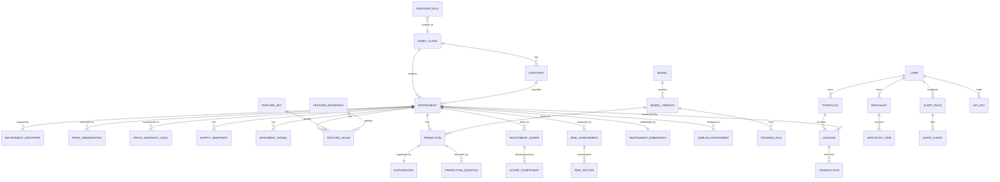

# 03 — Database Design

The database is the system of record and the shape that makes (or breaks) extensibility. This chapter specifies the schema: design principles, the generic asset model, the entity-relationship diagram, TimescaleDB usage, and every table's columns, types, keys, indexes, and normalization rationale.

Engine: **PostgreSQL 16** + **TimescaleDB** (time-series) + **pgvector** (embeddings), one datastore for all three data shapes ([ADR-0003](adr/0003-postgres-timescaledb-primary-store.md)).

## 1. Design principles

1. **Asset-class-agnostic core.** No table encodes "Pokémon." Class-specific fields live in `instruments.attributes` (JSONB, validated by the plugin's schema) or optional per-class attribute tables ([ADR-0004](adr/0004-generic-asset-model-and-plugin-registry.md)).
2. **Append-only raw, derived-and-versioned everything else.** `price_observations` is immutable and append-only; snapshots, features, predictions, scores are derived and carry the versions that produced them → full reproducibility, no look-ahead leakage.
3. **Point-in-time correctness.** Every derived row is stamped with the `as_of` timestamp and the input versions, so we can reconstruct exactly what was known when.
4. **Normalize transactional data (3NF); denormalize hot reads.** Users/portfolio/transactions are strictly normalized for integrity; time-series snapshots and derived scores are deliberately denormalized/materialized for read speed.
5. **Time-series → hypertables.** High-volume, time-ordered tables are Timescale hypertables with continuous aggregates, compression, and retention.
6. **Everything has provenance and timestamps.** `created_at`, `updated_at`, and `source` where applicable.
7. **UUID surrogate keys** (`uuid` v7 for time-orderable PKs) for external-facing entities; natural keys enforced via unique constraints.

## 2. Entity-relationship diagram (core)

## 3. Enumerated types

Defined as Postgres `enum`s (or lookup tables where values churn):

- `asset_class_code`: `pokemon_sealed` (future: `mtg_sealed`, `sports_cards`, ...).
- `price_kind`: `sold` | `listing` | `guide` | `consolidated`.
- `condition`: `sealed` | `used` | `graded` | `unknown` (grade detail in attributes).
- `data_source`: `pokemontcg` | `ebay_browse` | `pricecharting` | `reddit` | `google_trends` | `youtube` | `psa` | `fred` | `synthetic` | `manual`.
- `reliability_tier`: `t1` | `t2` | `t3`.
- `model_stage`: `none` | `staging` | `production` | `archived`.
- `horizon`: `d30` | `d90` | `d365` (extensible).
- `txn_type`: `buy` | `sell` | `adjust`.
- `alert_kind`: `price_above` | `price_below` | `score_above` | `pct_change` | `undervalued` | `bubble` | `custom`.

---

## 4. Catalog & asset model

### `asset_classes`

| Column | Type | Key | Notes |
|--------|------|-----|-------|
| id | smallint | PK | small, stable |
| code | asset_class_code | UQ | e.g. `pokemon_sealed` |
| name | text | | display |
| attribute_schema | jsonb | | JSON Schema the plugin validates instrument attributes against |
| default_currency | char(3) | | ISO 4217 |
| is_active | boolean | | |
| created_at | timestamptz | | |

*Normalization:* the registry row for each plugin; `attribute_schema` lets the DB (and API) validate class-specific attributes without class-specific columns.

### `categories`

| Column | Type | Key | Notes |
|--------|------|-----|-------|
| id | int | PK | |
| asset_class_id | smallint | FK→asset_classes | |
| code | text | | e.g. `etb`, `booster_box`, `upc` |
| name | text | | |
| parent_id | int | FK→categories (self) | hierarchy |

*Index:* unique `(asset_class_id, code)`.

### `instruments`

The central entity — one row per tracked product.

| Column | Type | Key | Notes |
|--------|------|-----|-------|
| id | uuid (v7) | PK | external-facing |
| asset_class_id | smallint | FK | |
| category_id | int | FK | |
| slug | text | UQ | URL-safe id |
| name | text | | "Prismatic Evolutions Elite Trainer Box" |
| currency | char(3) | | pricing currency |
| release_date | date | | drives lifecycle features |
| msrp | numeric(12,2) | | anchor for synthetic + valuation |
| status | text | | `active`/`preorder`/`retired` |
| attributes | jsonb | | class-specific (set, series, print run est., is_pokemon_center_exclusive, ...) validated vs `attribute_schema` |
| first_tracked_at | timestamptz | | when we began collecting |
| created_at / updated_at | timestamptz | | |

*Indexes:* PK; UQ `slug`; btree `(asset_class_id, category_id)`; **GIN** on `attributes` (e.g. `attributes->>'set'` queries); `release_date`.
*Normalization:* common columns are 3NF; the JSONB `attributes` is the deliberate, validated escape hatch for class-specific fields ([ADR-0004](adr/0004-generic-asset-model-and-plugin-registry.md)). Per-class typed tables (e.g. `pokemon_set_attributes`) may be added when a field needs heavy relational querying.

### `instrument_identifiers`

Maps external source IDs → our instrument (resolution/dedupe backbone).

| Column | Type | Key | Notes |
|--------|------|-----|-------|
| id | bigint | PK | |
| instrument_id | uuid | FK | |
| source | data_source | | |
| external_id | text | | UPC, pricecharting id, tcgplayer product id, ebay category+query hash |
| confidence | numeric(3,2) | | for fuzzy matches |
| is_primary | boolean | | |

*Index:* unique `(source, external_id)`; btree `(instrument_id)`.

### `instrument_aliases`

Free-text aliases for the title matcher (eBay/YouTube resolution).

| Column | Type | Key | Notes |
|--------|------|-----|-------|
| id | bigint | PK | |
| instrument_id | uuid | FK | |
| alias | text | | normalized lowercase |
| source_hint | data_source | | optional |

*Index:* trigram (GIN `gin_trgm_ops`) on `alias` for fuzzy match.

### `fx_rates`

| Column | Type | Key | Notes |
|--------|------|-----|-------|
| day | date | PK part | |
| base | char(3) | PK part | |
| quote | char(3) | PK part | |
| rate | numeric(18,8) | | to convert base→quote |

*Purpose:* deterministic currency→USD normalization with historical accuracy.

---

## 5. Market data (time-series)

### `price_observations` — hypertable (append-only, raw)

The immutable record of every price point we ever saw.

| Column | Type | Key | Notes |
|--------|------|-----|-------|
| observed_at | timestamptz | PK part / partition | Timescale time dim |
| id | bigint | PK part | |
| instrument_id | uuid | FK | |
| source | data_source | | |
| kind | price_kind | | `listing`/`guide`/`consolidated` (no `sold` from eBay; see [02](02-data-sources.md)) |
| condition | condition | | |
| price | numeric(12,2) | | as-reported |
| currency | char(3) | | |
| price_usd | numeric(12,2) | | normalized |
| sample_size | int | | e.g. # listings behind a guide value |
| is_outlier | boolean | | MAD-based flag (kept, not deleted) |
| url | text | | provenance |
| raw_ref | jsonb | | minimal raw payload ref |
| ingested_at | timestamptz | | |

*Hypertable:* `create_hypertable('price_observations','observed_at', chunk_time_interval => 7 days)`.
*Indexes:* composite `(instrument_id, observed_at DESC)`; `(source, observed_at)`; unique dedupe `(instrument_id, source, kind, condition, observed_at, price_usd)`.
*Compression:* compress chunks older than 90 days (segment by `instrument_id`).
*Retention:* keep raw ≥ 24 months, then rely on snapshots (policy configurable).

### `supply_snapshots` — hypertable

Active-listing supply per instrument per day (from eBay Browse).

| Column | Type | Key | Notes |
|--------|------|-----|-------|
| observed_at | timestamptz | PK part | |
| instrument_id | uuid | FK / PK part | |
| source | data_source | | |
| active_listings | int | | count for sale |
| min_ask_usd | numeric(12,2) | | |
| median_ask_usd | numeric(12,2) | | |
| depth | jsonb | | ask buckets |

*Index:* `(instrument_id, observed_at DESC)`.

### `price_snapshots_daily` — hypertable (the modeling grain)

One consolidated, cleaned record per instrument per day: the robust central price plus co-located supply/attention for convenient feature joins.

| Column | Type | Key | Notes |
|--------|------|-----|-------|
| day | date | PK part | |
| instrument_id | uuid | FK / PK part | |
| price_usd | numeric(12,2) | | robust central estimate across sources (median of guide/listing, outliers excluded) |
| price_low / price_high | numeric(12,2) | | intra-day range/dispersion |
| n_sources | smallint | | how many sources contributed |
| active_listings | int | | from supply |
| sold_listed_ratio | numeric(6,3) | | demand proxy (when available) |
| data_source | data_source | | `consolidated` or `synthetic` |
| is_synthetic | boolean | | quarantine flag ([ADR-0005](adr/0005-synthetic-historical-backfill.md)) |

*Index:* `(instrument_id, day DESC)`; partial index `WHERE is_synthetic = false`.
*Continuous aggregates:* weekly/monthly rollups (`price_snapshots_weekly`) materialized from this table for fast charts.

---

## 6. Alternative data

### `sentiment_signals` — hypertable

| Column | Type | Notes |
|--------|------|-------|
| window_end | timestamptz | PK part (time dim) |
| instrument_id | uuid | FK (nullable for market-wide) |
| source | data_source | reddit/youtube |
| mentions | int | volume |
| sentiment_mean | numeric(4,3) | −1..1 |
| sentiment_std | numeric(4,3) | dispersion |
| engagement | int | score/comments/views |

### `trends_series` — hypertable

| Column | Type | Notes |
|--------|------|-------|
| ts | timestamptz | PK part |
| term | text | search term |
| instrument_id | uuid | FK (nullable) |
| geo | text | default `US` |
| value | numeric(6,2) | interest |
| scaling_ref | text | official-API scaling basis |

### `population_reports` (optional, best-effort)

| Column | Type | Notes |
|--------|------|-------|
| id | bigint | PK |
| instrument_id | uuid | FK (nullable; may key on set) |
| as_of | date | |
| grade_counts | jsonb | `{ "10": n, "9": n, ... }` |
| total | int | |
| source | data_source | psa/third-party |

### `macro_series` — hypertable

| Column | Type | Notes |
|--------|------|-------|
| day | date | PK part |
| code | text | e.g. `FEDFUNDS`, `CPIAUCSL` |
| value | numeric(18,6) | |
| vintage | date | as-of release date (avoid revision leakage) |
| units / frequency | text | |

---

## 7. Feature store

### `feature_definitions`

| Column | Type | Notes |
|--------|------|-------|
| id | int | PK |
| key | text | UQ, e.g. `mom_30d`, `supply_growth_30d` |
| group | text | technical/supply/lifecycle/sentiment/macro |
| dtype | text | float/int/bool |
| description | text | |
| formula_ref | text | link to [04](04-feature-engineering.md) |
| leakage_notes | text | |

### `feature_sets`

Versioned bundles of features used to train a model (reproducibility).

| Column | Type | Notes |
|--------|------|-------|
| id | int | PK |
| version | text | UQ, e.g. `fs_2026_06` |
| definition_ids | int[] | members |
| created_at | timestamptz | |

### `feature_values` — hypertable (point-in-time)

| Column | Type | Notes |
|--------|------|-------|
| as_of | date | PK part (time dim) |
| instrument_id | uuid | FK / PK part |
| feature_set_id | int | FK / PK part |
| values | jsonb | `{ "mom_30d": 0.12, ... }` (wide-as-JSONB) |
| is_synthetic | boolean | inherits from snapshot |

*Design choice:* JSONB values keep the feature set **schema-flexible and versioned** without DDL churn as features are added; a materialized wide view is generated per `feature_set` for fast model I/O. Index `(instrument_id, as_of DESC, feature_set_id)`.

---

## 8. ML lifecycle

### `models`

| Column | Type | Notes |
|--------|------|-------|
| id | int | PK |
| name | text | UQ, e.g. `sealed_return_forecaster` |
| asset_class_id | smallint | FK |
| horizon | horizon | |
| task | text | regression (log-return) |
| description | text | |

### `model_versions`

| Column | Type | Notes |
|--------|------|-------|
| id | uuid | PK |
| model_id | int | FK |
| version | text | UQ per model (semver or run id) |
| algo | text | lightgbm/xgboost/tft/ensemble |
| feature_set_id | int | FK |
| stage | model_stage | staging/production/archived |
| mlflow_run_id | text | link to registry |
| artifact_uri | text | object store |
| metrics | jsonb | holdout RMSE/MAE/MAPE/dir-acc/coverage |
| created_at | timestamptz | |

*Index:* partial unique `(model_id) WHERE stage='production'` (exactly one champion per model).

### `training_runs`

| Column | Type | Notes |
|--------|------|-------|
| id | uuid | PK |
| model_version_id | uuid | FK |
| dataset_uri | text | versioned parquet |
| cv_scheme | text | walk-forward config |
| best_params | jsonb | Optuna |
| cv_metrics | jsonb | per-fold |
| started_at / finished_at | timestamptz | |
| status | text | success/failed |

### `predictions` (+ quantiles) — hypertable

| Column | Type | Notes |
|--------|------|-------|
| predicted_at | timestamptz | PK part |
| id | uuid | PK part |
| instrument_id | uuid | FK |
| model_version_id | uuid | FK |
| horizon | horizon | |
| as_of_day | date | feature date used |
| point_return | numeric(8,5) | predicted log/target return |
| point_price_usd | numeric(12,2) | implied price |
| feature_set_id | int | FK (reproducibility) |
| is_synthetic | boolean | |

`prediction_quantiles`:

| Column | Type | Notes |
|--------|------|-------|
| prediction_id | uuid | FK (PK part) |
| quantile | numeric(4,3) | 0.05/0.25/0.5/0.75/0.95 |
| value_return | numeric(8,5) | |
| value_price_usd | numeric(12,2) | |

*Index:* `(instrument_id, horizon, predicted_at DESC)`.

### `explanations`

| Column | Type | Notes |
|--------|------|-------|
| prediction_id | uuid | PK/FK (1:1) |
| method | text | shap_tree/shap_deep |
| base_value | numeric(10,6) | SHAP expected value |
| contributions | jsonb | `[{feature, value, shap}]` sorted by |shap| |
| narrative | text | guarded NL summary ([08](08-explainable-ai.md)) |
| created_at | timestamptz | |

### `inference_logs`, `drift_reports`

- `inference_logs`: request-level latency, model_version, cache hit/miss, input hash — for observability and reproducibility.
- `drift_reports`: scheduled Evidently outputs (feature drift, target drift, calibration) per model_version → triggers retrain review.

---

## 9. Derived signals

### `investment_scores` (+ components)

| Column | Type | Notes |
|--------|------|-------|
| id | uuid | PK |
| instrument_id | uuid | FK |
| as_of | date | |
| score | numeric(5,2) | 0–100 |
| grade | text | A+…F band |
| model_version_id | uuid | FK (forecast used) |
| inputs_hash | text | reproducibility |

`score_components`:

| Column | Type | Notes |
|--------|------|-------|
| score_id | uuid | FK (PK part) |
| component | text | expected_return/risk_adjusted/liquidity/supply/demand/reprint/confidence/momentum |
| raw_value | numeric | |
| normalized | numeric(5,2) | 0–100 |
| weight | numeric(4,3) | |
| contribution | numeric(6,3) | weight × normalized |

*Rationale:* storing components (not just the final score) is what makes the score **explainable and auditable** ([06](06-investment-score.md)).

### `risk_assessments` (+ factors)

| Column | Type | Notes |
|--------|------|-------|
| id | uuid | PK |
| instrument_id | uuid | FK |
| as_of | date | |
| overall_risk | numeric(5,2) | 0–100 |
| band | text | low/medium/high |

`risk_factors`:

| Column | Type | Notes |
|--------|------|-------|
| assessment_id | uuid | FK |
| factor | text | reprint/crash/oversupply/liquidity/bubble/macro/fatigue |
| probability | numeric(4,3) | 0–1 |
| severity | numeric(4,3) | 0–1 |
| score | numeric(5,2) | prob×severity scaled |
| narrative | text | |

---

## 10. Similarity & embeddings

### `instrument_embeddings` (pgvector)

| Column | Type | Notes |
|--------|------|-------|
| instrument_id | uuid | PK/FK |
| embedding | vector(N) | feature-space or learned embedding |
| method | text | featurescale/autoencoder |
| updated_at | timestamptz | |

*Index:* HNSW (`vector_cosine_ops`) for ANN.

### `clusters`, `cluster_members`, `similar_instruments`

- `clusters(id, method, k, created_at)`, `cluster_members(cluster_id, instrument_id, distance)`.
- `similar_instruments(instrument_id, neighbor_id, similarity, method, rank)` — precomputed nearest neighbors and lifecycle-aligned **analogues** ([09](09-similarity-search.md)); index `(instrument_id, rank)`.

---

## 11. Users, portfolio, engagement

### `users`, `api_keys`, `refresh_tokens`

| `users` | Type | Notes |
|---------|------|-------|
| id | uuid | PK |
| email | citext | UQ |
| password_hash | text | Argon2id |
| role | text | user/pro/admin |
| is_active | boolean | |
| created_at | timestamptz | |

- `api_keys(id, user_id, prefix, hash, scopes[], rate_limit, last_used_at, revoked_at)` — hashed keys, per-key scope + limit.
- `refresh_tokens(id, user_id, token_hash, expires_at, revoked_at, user_agent)` — rotation + revocation.

### `portfolios`, `holdings`, `transactions`

| `portfolios` | Type | Notes |
|--------------|------|-------|
| id | uuid | PK |
| user_id | uuid | FK |
| name | text | |
| base_currency | char(3) | |

| `holdings` | Type | Notes |
|------------|------|-------|
| id | uuid | PK |
| portfolio_id | uuid | FK |
| instrument_id | uuid | FK |
| quantity | numeric(12,3) | derived from transactions |
| avg_cost_usd | numeric(12,2) | derived (running) |

| `transactions` | Type | Notes |
|----------------|------|-------|
| id | uuid | PK |
| holding_id | uuid | FK |
| type | txn_type | buy/sell/adjust |
| quantity | numeric(12,3) | |
| unit_price_usd | numeric(12,2) | |
| fees_usd | numeric(12,2) | |
| executed_at | timestamptz | |

*Normalization:* `holdings.quantity`/`avg_cost` are **derived** from immutable `transactions` (event-sourced position); we materialize them for read speed and recompute on transaction change. Unique `(portfolio_id, instrument_id)` per holding.

### `watchlists`, `watchlist_items`

- `watchlists(id, user_id, name)`, `watchlist_items(watchlist_id, instrument_id, added_at)` — unique `(watchlist_id, instrument_id)`.

### `alert_rules`, `alert_events`, `notifications`

| `alert_rules` | Type | Notes |
|---------------|------|-------|
| id | uuid | PK |
| user_id | uuid | FK |
| instrument_id | uuid | FK (nullable = market-wide) |
| kind | alert_kind | |
| params | jsonb | threshold, direction, window |
| channel | text | email/push/webhook |
| is_active | boolean | |
| cooldown_minutes | int | dedupe |

*Index:* partial `WHERE is_active` for the evaluator.

- `alert_events(id, rule_id, fired_at, context jsonb)` — edge-triggered firings within a cooldown window.
- `notifications(id, user_id, event_id, status, sent_at)` — delivery tracking.

---

## 12. Operations

### `provider_runs`

| Column | Type | Notes |
|--------|------|-------|
| id | uuid | PK |
| source | data_source | |
| asset_class_id | smallint | FK |
| started_at / finished_at | timestamptz | |
| rows_fetched | int | |
| errors | int | |
| budget_consumed | int | rate-limit units |
| status | text | success/partial/failed |
| detail | jsonb | |

### `data_quality_flags`

Records anomalies (gaps, spikes, source disagreement) for the admin dashboard and to gate model training on quality.

### `audit_log`

Append-only record of privileged/admin actions `(id, actor_id, action, entity, entity_id, at, metadata)`.

---

## 13. Indexing & performance summary

- **Time-series reads** ("last N days for instrument"): composite `(instrument_id, time DESC)` on every hypertable; continuous aggregates for chart zoom levels.
- **Attribute queries** ("all ETBs in set X"): GIN on `instruments.attributes`.
- **Fuzzy matching** (ingestion resolution): trigram GIN on `instrument_aliases.alias`.
- **Vector search**: HNSW on `instrument_embeddings.embedding`.
- **Hot derived reads** (product page): latest `investment_scores`, `predictions`, `risk_assessments` fetched by `(instrument_id, as_of DESC)`; cached in Redis keyed by versions.
- **Write path** (ingestion) isolated to raw/hypertables; analytics served from replicas at scale ([01 §9](01-system-architecture.md#9-scalability-strategy)).

## 14. Migrations & seeding

- Schema managed by **Alembic**; Timescale hypertable creation and policies live in dedicated migration steps.
- **Seeds:** asset-class registration (`pokemon_sealed`), category taxonomy, an initial instrument catalog (from PokemonTCG.io sets + a curated sealed-product list), and FX rates.
- **Synthetic history** ([ADR-0005](adr/0005-synthetic-historical-backfill.md)) is generated into `price_snapshots_daily`/`feature_values` with `is_synthetic = true` for development.

Continue to [04 — Feature Engineering](04-feature-engineering.md).
