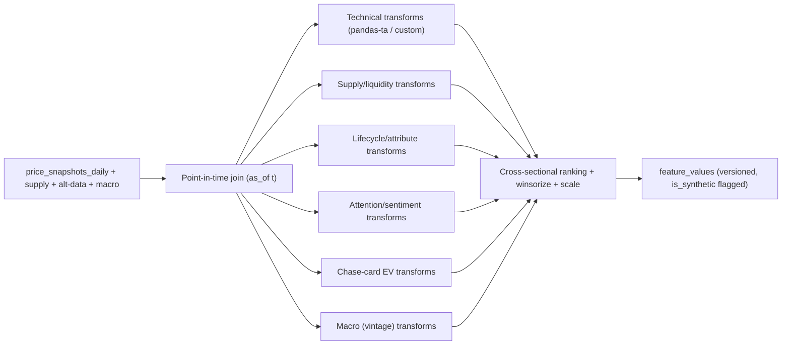

# 04 — Feature Engineering

Features are where domain insight becomes predictive signal. This chapter is written from a quantitative-analyst perspective: it defines the prediction target, the point-in-time discipline that prevents leakage, then a full feature catalog grouped by theme. Every feature lists its **formula**, **rationale**, **leakage risk**, and **expected predictive power**.

All features are computed **as-of a date** using only information available on or before that date, and materialized into the versioned feature store ([03 §7](03-database-design.md#7-feature-store)).

## 1. Prediction target

We forecast **forward log-return** over a horizon `h ∈ {30, 90, 365}` days rather than raw price. Reasons:

- Returns are (closer to) stationary and comparable across instruments of very different price levels; raw price is not.
- Log-returns are additive across time and symmetric, which stabilizes training and interval estimation.

```
target_h(i, t) = log( price(i, t + h) / price(i, t) )
```

where `price` is the consolidated daily snapshot ([03 §5](03-database-design.md#5-market-data-time-series)). The implied price forecast is recovered as `price(i,t) * exp(pred)`. We also derive a **directional label** (`sign(target_h)`) for directional-accuracy metrics and a **probability-of-target-return** used by Monte Carlo ([11](11-ai-features.md)).

## 2. Leakage taxonomy and mitigations

Leakage is the number-one way time-series ML lies to you. We defend against each class explicitly:

| Leakage type | Example | Mitigation |
|--------------|---------|------------|
| **Look-ahead** | Using a value not yet known at `t` | Point-in-time feature build; every feature reads only `≤ t` data; features stamped with `as_of` |
| **Target leakage** | A feature that encodes the future price | No feature may use data from `(t, t+h]`; audited in `feature_definitions.leakage_notes` |
| **Train/test contamination** | Scaler/encoder fit on the whole series | Fit transforms inside each walk-forward train fold only ([05](05-machine-learning.md)) |
| **Macro revision leakage** | Using revised macro values as if known at `t` | Use `macro_series.vintage` (as-first-released) values |
| **Survivorship** | Dropping delisted/retired products | Retired instruments retained; delisting is itself a feature/label |
| **Cross-sectional leakage** | Percentile rank computed using future cross-section | Cross-sectional stats computed per date over the *then-known* universe |

## 3. Normalization & encoding conventions

- **Cross-sectional standardization:** many raw features are converted to a per-date **z-score or percentile rank within the asset class/category**, so "momentum" means "relative to peers now," which is robust to regime shifts.
- **Winsorization:** heavy-tailed features clipped at the 1st/99th cross-sectional percentiles before scaling.
- **Categoricals:** low-cardinality (category, exclusivity) one-hot; high-cardinality (set/series) target-encoded **within fold** or embedded.
- **Missing values:** never silently zero-filled. Tier-3-derived features carry an explicit `*_is_missing` companion flag; tree models handle NaNs natively, and the model must perform without any single feature group ([02 §3](02-data-sources.md#3-reliability-tiers)).

---

## 4. Feature catalog

Importance labels (H/M/L) are **priors** to be validated by SHAP + permutation importance ([08](08-explainable-ai.md)); they set expectations, not conclusions.

### 4.1 Price / technical features

Computed on the consolidated daily price series. `P_t` = price at `t`; `r_t = log(P_t/P_{t-1})`.

| Key | Formula | Rationale | Leakage risk | Importance |
|-----|---------|-----------|--------------|-----------|
| `ret_{7,30,90}d` | `log(P_t / P_{t-k})` | Recent trend; the strongest naive signal in collectibles | Low (past-only) | H |
| `logret_1d` | `r_t` | Base return unit | Low | M |
| `sma_{7,30,90}` | mean of `P` over k | Trend baseline | Low | M |
| `ema_{12,26}` | exp-weighted mean | Reactive trend | Low | M |
| `macd` | `ema_12 − ema_26` | Momentum turn detection | Low | M |
| `macd_signal/hist` | `ema_9(macd)`, `macd−signal` | Momentum acceleration | Low | M |
| `rsi_14` | `100 − 100/(1+RS)`, `RS = avg gain/avg loss` | Overbought/oversold; bubble hint | Low | M |
| `boll_pctb_20` | `(P_t − lower)/(upper − lower)` | Position within volatility band | Low | M |
| `boll_width_20` | `(upper − lower)/sma_20` | Volatility regime | Low | M |
| `atr_14` | avg true range | Absolute volatility | Low | M |
| `vol_{30,90}d` | std of `r` over k (annualized) | Risk & interval width driver | Low | H |
| `momentum_{30,90}` | `P_t/P_{t-k} − 1` | Cross-sectional momentum factor | Low | H |
| `price_accel` | `ret_30d − ret_30d(prev 30d)` | Second derivative; froth/exhaustion | Low | M |
| `max_drawdown_180d` | min over window of `P/roll_max − 1` | Downside history | Low | M |
| `dist_from_high_365` | `P_t/roll_max_365 − 1` | Recovery/exhaustion vs peak | Low | M |
| `dist_from_low_365` | `P_t/roll_min_365 − 1` | Base-building | Low | L |
| `price_z_vs_sma90` | `(P_t − sma_90)/std_90` | Mean-reversion pressure | Low | M |

### 4.2 Supply, liquidity & demand-pressure features

From `supply_snapshots` (eBay Browse active listings) and, where available, sold/listed proxies. In collectibles, **supply dynamics often dominate**.

| Key | Formula | Rationale | Leakage risk | Importance |
|-----|---------|-----------|--------------|-----------|
| `active_listings` | count for sale at `t` | Raw supply | Low | M |
| `supply_growth_{30,90}d` | `log(listings_t / listings_{t-k})` | Rising supply → price pressure; falling → scarcity | Low | H |
| `sold_listed_ratio` | sales / active listings (when available) | Demand vs supply balance | Medium (needs sold proxy) | H |
| `days_on_market_proxy` | median listing age / turnover proxy | Liquidity/illiquidity | Medium | M |
| `min_ask_gap` | `(min_ask − P_t)/P_t` | Undercutting → downward pressure | Low | M |
| `ask_dispersion` | std/median of asks | Price discovery uncertainty | Low | L |
| `liquidity_score` | blend of turnover, listing depth, spread (see [06](06-investment-score.md)) | Executability of a position | Low | H |
| `supply_shock_flag` | 1 if `supply_growth_30d > τ` | Reprint/dump detection | Low | M |

### 4.3 Lifecycle & product features

Structural attributes; these encode the *collectible-specific* dynamics (release timing, scarcity, reprint risk).

| Key | Formula / source | Rationale | Leakage risk | Importance |
|-----|------------------|-----------|--------------|-----------|
| `months_since_release` | `(t − release_date)/30` | The master lifecycle clock (sealed appreciates post-cutoff) | Low | H |
| `years_since_release` | `(t − release_date)/365` | Long-run scarcity/vintage premium | Low | M |
| `days_to_print_cutoff_est` | est. end-of-print − `t` | Supply inflection point | Low (estimate) | M |
| `is_preorder` | status flag | Pre-release dynamics differ | Low | M |
| `category_*` | one-hot (ETB/booster box/UPC/…) | Different categories behave differently | Low | M |
| `is_center_exclusive` | attribute | Distribution scarcity | Low | M |
| `msrp` | attribute | Valuation anchor | Low | M |
| `price_to_msrp` | `P_t / msrp` | Appreciation vs issue price | Low | H |
| `print_run_est` | attribute/estimate | Scarcity proxy (often unknown) | Low (missing-prone) | M |
| `set_size` | attribute | EV/pull-rate context | Low | L |
| `reprint_probability` | model/heuristic from set age, series reprint history, demand ([07](07-risk-engine.md)) | Key downside driver | Medium (must be past-only) | H |

### 4.4 Attention & sentiment features

From Google Trends, YouTube, Reddit (Tier 2/3; degrade gracefully). These often **lead** price because interest precedes purchase.

| Key | Formula | Rationale | Leakage risk | Importance |
|-----|---------|-----------|--------------|-----------|
| `trends_level` | interest value at `t` (weekly ffill) | Baseline demand attention | Low | M |
| `trends_mom_{4,12}w` | `level_t/level_{t-k} − 1` | Rising search → rising demand | Low | H |
| `trends_breakout` | z-score vs trailing 52w | Regime shift in attention | Low | M |
| `yt_opening_velocity` | Δ opening/unboxing videos per week | Consumption rate (affects sealed scarcity narrative) | Low | M |
| `yt_view_momentum` | Δ views on relevant videos | Attention intensity | Low | L |
| `reddit_mentions_mom` | Δ mentions/week | Community attention | Low | M |
| `reddit_sentiment_mean` | mean polarity in window | Bullish/bearish tone | Low | M |
| `reddit_sentiment_mom` | Δ sentiment | Tone shift (often > level) | Low | M |
| `attention_composite` | weighted blend of the above | Denoised attention factor | Low | M |
| `*_is_missing` | flag | Tier-3 availability | n/a | — |

### 4.5 Chase-card / expected-value features

Unique to sealed TCG products: a box's value is partly the expected value of the singles inside it. Built from PokemonTCG.io single-card prices ([02 §4.1](02-data-sources.md#41-pokemontcgio--primary-catalog-tier-1-free)).

| Key | Formula | Rationale | Leakage risk | Importance |
|-----|---------|-----------|--------------|-----------|
| `pack_ev` | `Σ_c P(pull c) · price_c` over set | Intrinsic "rip value" floor | Low | H |
| `ev_to_price` | `pack_ev / P_t` | Sealed cheaper than its EV → undervalued signal | Low | H |
| `top_chase_price` | max single price in set | Hype/ceiling driver | Low | M |
| `chase_price_mom_30d` | Δ top chase price | Singles heat leads sealed | Low | M |
| `singles_index_ret` | return of set's singles basket | Cross-market linkage | Low | M |

### 4.6 Scarcity & relative-strength features

| Key | Formula | Rationale | Leakage risk | Importance |
|-----|---------|-----------|--------------|-----------|
| `scarcity_index` | fn(supply_growth, months_since_release, print_run_est, pop growth) | Composite scarcity ([06](06-investment-score.md)) | Low | H |
| `rel_strength_cat` | `ret_90d − ret_90d(category index)` | Outperformance vs peers | Low (past-only) | M |
| `momentum_rank_cat` | cross-sectional percentile of `momentum_90` in category | Robust relative momentum | Low | H |
| `beta_to_market` | rolling regression of `r_i` on market index return | Systematic exposure | Low | M |

### 4.7 Macro features

From FRED + public index proxies; use **vintage** values to avoid revision leakage.

| Key | Formula / series | Rationale | Leakage risk | Importance |
|-----|------------------|-----------|--------------|-----------|
| `fed_funds` | `FEDFUNDS` | Rates ↑ → discretionary spend ↓ | Low (vintage) | M |
| `treasury_10y` | `DGS10` | Discount-rate/risk-appetite proxy | Low | L |
| `cpi_yoy` | YoY of `CPIAUCSL` | Inflation → nominal appreciation & squeeze | Low | M |
| `consumer_sentiment` | `UMCSENT` | Willingness to spend on collectibles | Low | M |
| `equity_index_ret_30d` | broad index return | Wealth effect / risk-on | Low | M |
| `crypto_index_ret_30d` | crypto proxy return | Speculative-capital correlation | Low | M |
| `disposable_income_yoy` | FRED series | Spending capacity | Low | L |

### 4.8 Calendar & seasonality features

| Key | Formula | Rationale | Leakage risk | Importance |
|-----|---------|-----------|--------------|-----------|
| `month`, `quarter` | from `t` | Seasonal demand | Low | M |
| `is_q4` | Oct–Dec flag | Holiday buying surge | Low | M |
| `days_to_christmas` | calendar distance | Gifting demand ramp | Low | M |
| `is_new_set_window` | near a major set release | Attention diverts to new product | Low | M |

---

## 5. Feature computation pipeline



Implementation notes: transforms are pure functions of a windowed frame; the pipeline is a Prefect flow ([01 §7.1](01-system-architecture.md#71-daily-ingestion-scheduled)); each `feature_set` version pins the exact definitions used, so a model always trains/serves on a reproducible schema; a materialized wide view per feature set gives models fast columnar I/O.

## 6. Feature selection & multicollinearity

Many technical features are correlated (SMA/EMA/momentum families). We:

1. Start from the full catalog (tree models tolerate redundancy well).
2. Prune with **permutation importance** + **SHAP** and drop features with negligible, unstable contribution.
3. Check **VIF**/correlation clusters and keep one representative per highly-collinear cluster for the linear baseline (GBMs keep more).
4. Track feature importance **over time**; a feature whose importance is unstable across walk-forward folds is a red flag (possible leakage or regime-specificity).

## 7. Expected top drivers (hypotheses to test)

Going in, the priors are that **supply dynamics** (`supply_growth`, `scarcity_index`, `sold_listed_ratio`), **lifecycle** (`months_since_release`, `price_to_msrp`, `reprint_probability`), **momentum/attention** (`momentum_90`, `trends_mom`, `ev_to_price`), and **volatility** (interval width) carry most signal — because collectible appreciation is fundamentally a supply-decline-meets-demand story, with attention as the leading indicator. [08 — Explainable AI](08-explainable-ai.md) turns these validated importances into per-prediction narratives, and [06 — Investment Score](06-investment-score.md) turns them into a decomposable rating.

Continue to [05 — Machine Learning](05-machine-learning.md).
