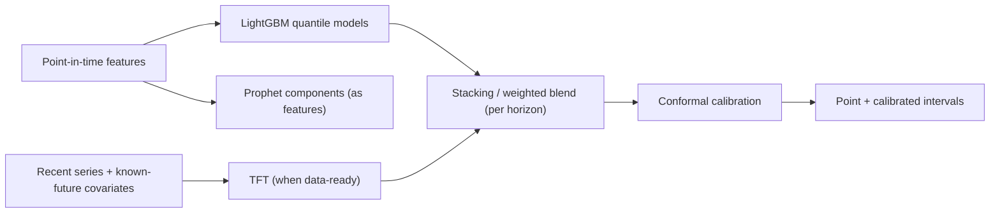
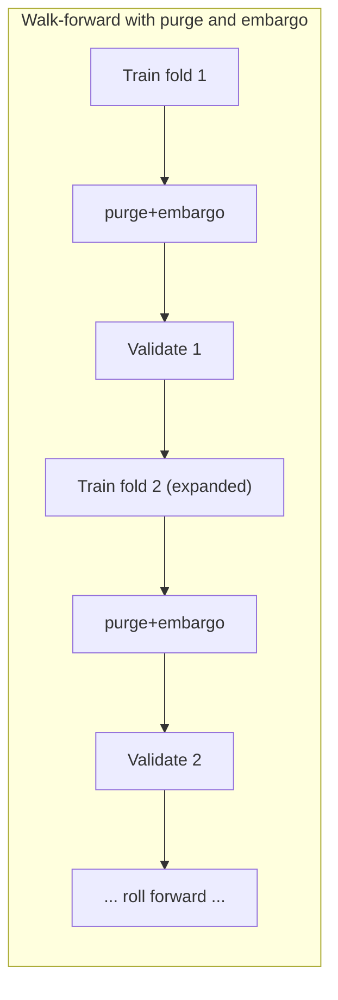
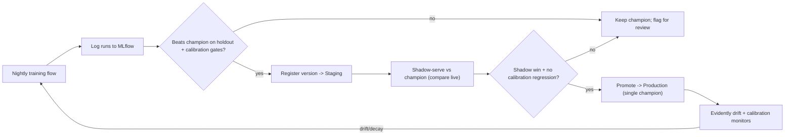

# 05 — Machine Learning

This chapter designs the forecasting system: how the problem is framed, the model zoo and why each model is (or is not) chosen, how we validate without fooling ourselves, the metrics we report, how we produce **calibrated uncertainty**, hyperparameter optimization, and the model lifecycle/registry. The governing principle: **honest baselines, leakage-proof validation, and shipped uncertainty** — a point estimate without an interval is not a deliverable here.

## 1. Problem framing

- **Task:** predict forward log-return `target_h` for horizon `h ∈ {30, 90, 365}` days ([04 §1](04-feature-engineering.md#1-prediction-target)).
- **Structure:** a **panel** (many instruments) of irregular-length, correlated time series with rich static + dynamic covariates. This favors models that pool across instruments (learn a global function) over one-model-per-instrument.
- **Primary model:** a **pooled cross-sectional regressor** that maps a point-in-time feature vector → return distribution. **Secondary model:** a **temporal sequence model** (TFT) that consumes the recent series + known-future covariates (calendar, release timing). They are combined in an ensemble.
- **Regime reality:** collectibles have fat tails, hype bubbles, and reprint shocks. We optimize for **robustness and calibration**, not squeezing the last basis point of RMSE.

## 2. Model zoo and comparison

| Model | Strengths | Weaknesses | Train cost | Inference | Interpretability | Native uncertainty | Role in PokéQuant |
|-------|-----------|------------|-----------|-----------|------------------|--------------------|-------------------|
| **Naive / seasonal-naive** | Zero-cost honest baseline (last value / drift) | No signal | none | instant | total | no | **Baseline gate** every model must beat |
| **Linear / Ridge / Lasso** | Interpretable, fast, great sanity check | Misses nonlinearity/interactions | low | instant | high (coefs) | via quantile reg | Baseline + feature sanity |
| **Random Forest** | Robust, low-tuning, nonlinear | Weaker extrapolation, larger models | med | fast | med (impurity/SHAP) | quantile-RF | Secondary baseline |
| **XGBoost** | Strong tabular accuracy, regularized | Tuning sensitive | med | fast | SHAP (TreeExplainer) | pinball quantiles | Ensemble member |
| **LightGBM** | Fast, handles NaNs/categoricals, quantile loss | Can overfit small data | low-med | very fast | SHAP | pinball quantiles | **Primary workhorse** |
| **CatBoost** | Best-in-class categorical handling, robust defaults | Slower train | med | fast | SHAP | quantiles | Ensemble member |
| **Prophet** | Decomposes trend/seasonality/holidays, interpretable | Univariate, weak with covariates/panel | low | fast | high (components) | intervals | Seasonality baseline + decomposition feature |
| **LSTM/GRU** | Learns temporal dynamics | Data-hungry, opaque, tuning-heavy | high | med | low (needs SHAP/attn) | MC-dropout/quantile | Considered; deprioritized vs TFT |
| **Transformer (vanilla)** | Long-range dependencies | Data-hungry, overkill for short panels | high | med | low | quantile heads | Not initially |
| **Temporal Fusion Transformer (TFT)** | Multi-horizon, static+dynamic+known-future covariates, built-in variable selection + quantile outputs + attention interpretability | Heavier to train/serve, needs enough history | high | med | med (attention + var-select) | **native quantiles** | **Secondary model** once real history matures |
| **Ensemble (stacking/blend)** | Usually best generalization + stability | Complexity, must guard leakage in stacking | med | fast-med | via components | inherited/conformal | **Production predictor** |

### Why this shortlist

- **LightGBM is the workhorse:** on small-to-medium tabular panels with engineered features, gradient-boosted trees consistently match or beat deep nets, train in seconds, handle missing values and categoricals natively, and pair perfectly with SHAP for explainability ([08](08-explainable-ai.md)). It also supports **quantile (pinball) loss** for native intervals.
- **TFT earns its complexity** only once we have enough real history: it natively does multi-horizon, ingests known-future covariates (release calendar, holidays), performs variable selection, and yields quantiles + attention we can explain. We gate its inclusion on data volume and a measured accuracy/calibration win.
- **Prophet** is not a competitive point predictor here, but its **trend/seasonality/holiday decomposition** is both an honest seasonal baseline and a useful *feature* (its components feed the GBM).
- **Linear + naive** are permanent citizens: if a fancy model can't beat seasonal-naive out-of-sample, it does not ship.



## 3. Validation: not fooling ourselves

Time-series validation is where most collectible/finance "models" quietly cheat. Our scheme:

- **Walk-forward (expanding-window) evaluation.** Train on `[t0, T_k]`, validate on `(T_k, T_k + Δ]`, roll forward. Report metrics per fold and aggregated — never a single random split.
- **Purging + embargo.** Because a label at `t` depends on prices in `(t, t+h]`, we **purge** training samples whose label window overlaps the validation window and **embargo** a buffer after it, preventing horizon-induced leakage (López de Prado style).
- **Grouped by instrument** where needed so the same instrument's adjacent samples don't straddle the split trivially.
- **Backtest of decisions, not just errors.** Beyond regression error, we backtest the *product*: does buying the top-scored basket beat a naive/random basket over held-out time? This measures whether the score is economically useful.
- **Synthetic caveat.** During bootstrap, all metrics run on synthetic data and are labeled *illustrative*; real metrics supersede them as history accrues ([ADR-0005](adr/0005-synthetic-historical-backfill.md)).



## 4. Metrics

Reported per horizon and per fold; aggregated with dispersion (mean ± std across folds).

**Point accuracy**

- **RMSE / MAE** on log-return (primary regression error).
- **MAPE** on price — reported with care (undefined/unstable for low prices; we use **sMAPE** or WAPE alongside).
- **R² vs. naive (skill score):** `1 − MSE_model / MSE_naive`; must be > 0 to justify the model.
- **Directional accuracy:** `mean(sign(pred) == sign(actual))`; economically the most relevant single number.

**Uncertainty quality**

- **Pinball (quantile) loss** averaged over quantiles — the proper score for interval forecasts.
- **PICP** (Prediction Interval Coverage Probability): empirical fraction of actuals inside the nominal interval (should ≈ nominal, e.g. 90%).
- **MPIW** (Mean Prediction Interval Width): sharpness; narrower is better *given* correct coverage.
- **Calibration curve / reliability:** predicted-quantile vs. empirical-coverage plot; summarized by a calibration error.

**Robustness**

- Metrics sliced by **regime** (bull/bear), **category**, **months-since-release** bucket, and **data-coverage** (synthetic vs real) to detect where the model is weak.

## 5. Prediction intervals & calibration

We treat uncertainty as a first-class output via a two-stage approach ([ADR-0010](adr/0010-quantile-prediction-intervals.md)):

1. **Quantile regression.** Train LightGBM with **pinball loss** at quantiles `{0.05, 0.25, 0.5, 0.75, 0.95}` (and TFT's native quantile heads) to get a raw predictive distribution. Pinball loss for quantile `q`:

```
L_q(y, ŷ) = max( q·(y − ŷ), (q − 1)·(y − ŷ) )
```

2. **Conformal calibration.** Quantile models are rarely perfectly calibrated out-of-sample, so we wrap them with **split/what conformal prediction** — specifically **Conformalized Quantile Regression (CQR)** — using a held-out calibration set to adjust interval widths so empirical coverage matches the nominal level with finite-sample guarantees. Calibration is monitored continuously; drift in PICP triggers recalibration/retraining.

The result surfaced to users: a **median forecast**, a **50% and 90% interval**, and a **model-confidence score** derived from (normalized, inverse) interval width + historical calibration — which also feeds the Investment Score ([06](06-investment-score.md)) and the risk narrative.

## 6. Hyperparameter optimization

- **Optuna** with the **TPE sampler** + **median/Hyperband pruning**, optimizing the walk-forward pinball/RMSE objective (not a single split).
- Search spaces (representative):
  - **LightGBM:** `num_leaves` (15–255), `max_depth` (−1, 3–12), `learning_rate` (log 1e-3–0.3), `min_child_samples` (5–200), `feature_fraction`/`bagging_fraction` (0.5–1.0), `lambda_l1/l2` (log 1e-3–10), `n_estimators` with early stopping.
  - **TFT:** hidden size, attention heads, dropout, learning rate, hidden continuous size, gradient clipping, epochs with early stopping.
- Every trial is logged to MLflow; the study is versioned so tuning is reproducible.

## 7. Ensembling

- **Per-horizon stacking/blend.** Base learners (LightGBM quantiles, TFT, Prophet-residual model) feed a **meta-learner** (regularized linear or a shallow GBM) trained **out-of-fold** (to avoid stacking leakage). For horizons/instruments with thin data, we fall back to a simple performance-weighted average.
- **Why ensemble:** it reduces variance and hedges model-specific failure modes (e.g., TFT overreacting to a hype spike vs. GBM's flatness), typically improving both accuracy and calibration.

## 8. Cold start & sparse instruments

New or thinly-traded instruments lack history. Strategies:

- **Hierarchical/pooled prior:** the global pooled model already generalizes across instruments, so a new instrument gets sensible predictions from its features alone.
- **Analogue prior:** blend in the trajectory of lifecycle-aligned historical analogues ([09 — Similarity Search](09-similarity-search.md)) — "products like this, at this age, did X."
- **Wider intervals:** conformal widths automatically widen when features are out-of-distribution or coverage history is thin, honestly signaling low confidence.

## 9. Model lifecycle & registry



- **MLflow** tracks params/metrics/artifacts and hosts the **model registry** with a `Staging → Production` lifecycle; exactly one `Production` version per `(model, horizon)` ([03 §8](03-database-design.md#8-ml-lifecycle)).
- **Promotion gates:** a challenger must beat the champion on the out-of-sample walk-forward objective **and** not regress calibration (PICP/MPIW) — accuracy at the cost of miscalibration is rejected.
- **Retraining cadence:** scheduled (e.g., weekly) plus **drift-triggered** (Evidently detects feature/target drift or calibration decay).
- **Reproducibility:** every `prediction` row references the exact `model_version_id` and `feature_set_id` that produced it, and every training run references a **versioned dataset** in object storage — any historical forecast/score/explanation can be regenerated byte-for-byte.

## 10. Serving

- **Batch (nightly):** recompute forecasts/intervals/scores for all tracked instruments after ingestion + feature build; persist to `predictions`/`prediction_quantiles`.
- **Online (on-demand):** the API serves cached batch results and recomputes on cache miss or when the user forces a refresh ([01 §7.3](01-system-architecture.md#73-prediction-request-online-cached)).
- **Inference isolation:** models are loaded from the registry by the inference service, which can scale independently of the API and go GPU-backed if TFT dominates ([01 §5](01-system-architecture.md#5-target-microservice-decomposition-when-we-outgrow-the-monolith)).

Continue to [06 — Investment Score](06-investment-score.md). The intervals and confidence defined here feed the score, the risk engine, and the Monte Carlo engine ([11](11-ai-features.md)).
