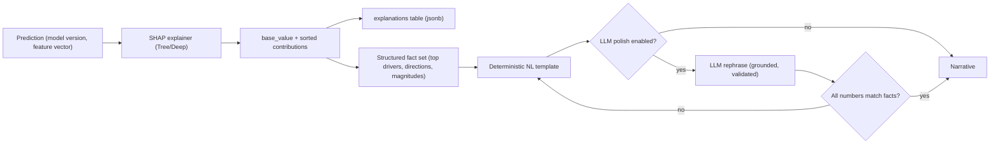

# 08 — Explainable AI

Explainability is a **hard product requirement**, not a nice-to-have ([ADR-0007](adr/0007-explainability-first-class.md)). Every forecast, score, and risk assessment PokéQuant surfaces MUST come with a faithful explanation of *why*. This chapter specifies the explainability pipeline: SHAP-based attributions (local + global), how they are stored, and how we generate natural-language summaries **without hallucinating numbers**.

## 1. Principles

- **No black-box outputs.** If we can't explain it, we don't present it as a signal.
- **Faithful, not plausible.** Explanations reflect what the model actually did (SHAP attributions), not a post-hoc story.
- **Additive and reconcilable.** SHAP is additive: contributions sum to the prediction. The Investment Score is additive by construction ([06](06-investment-score.md)). So a prediction's SHAP drivers and its score components should tell a **consistent** story — we check this.
- **Numbers come from computation, language comes from templates (optionally polished by an LLM under guardrails).** The LLM never invents figures.

## 2. What gets explained

| Output | Explanation method |
|--------|--------------------|
| Return forecast | SHAP attributions over the feature vector (per instrument, per horizon) |
| Prediction interval / confidence | interval width + calibration history, phrased as confidence |
| Investment Score | stored component contributions `w_k·c_k` + penalties ([06](06-investment-score.md)) |
| Risk assessment | per-factor probability × severity narratives ([07](07-risk-engine.md)) |
| Similar products | distance decomposition + lifecycle alignment ([09](09-similarity-search.md)) |

## 3. SHAP pipeline

- **Tabular models (LightGBM/XGBoost/CatBoost):** `shap.TreeExplainer` — exact, fast Shapley values for tree ensembles. Yields `base_value` (expected model output) + per-feature contributions summing to the prediction.
- **TFT / deep models:** gradient-based SHAP (`DeepExplainer`/`GradientExplainer`) and the model's **native variable-selection weights + temporal attention**, which are themselves interpretable.
- **Ensembles:** SHAP is computed per base model and combined by the ensemble's blend weights (SHAP is linear under weighted averaging), or via a surrogate on the blended output when needed.
- **Global explainability:** aggregate |SHAP| across the population → global feature importance; SHAP dependence/PDP plots for shape of effects; per-cohort importance (by category, months-since-release bucket, regime) to detect where different drivers dominate. Global views validate the feature-importance priors from [04 §7](04-feature-engineering.md#7-expected-top-drivers-hypotheses-to-test) and surface leakage (a suspiciously dominant feature is investigated).
- **Local explainability:** per-prediction SHAP waterfall — the top positive/negative contributors for *this* instrument *now*.

## 4. Storage

Each prediction has a 1:1 `explanations` row ([03 §8](03-database-design.md#8-ml-lifecycle)): `method`, `base_value`, `contributions` (JSONB array of `{feature, feature_value, shap}` sorted by |shap|), and the generated `narrative`. Because it references the exact `model_version_id` + `feature_set_id`, any explanation is reproducible.

## 5. Natural-language generation with anti-hallucination guardrails

This is the crux: LLMs are great at phrasing and terrible at arithmetic and faithfulness. So we **separate the facts from the prose**:

1. **Extract structured facts** from SHAP + score/risk components: the top N drivers, each with human-readable name, direction (increases/decreases), relative magnitude, and the underlying feature value (e.g., `{"driver": "supply_growth_90d", "direction": "down", "effect": "+", "value": "-18%"}`).
2. **Deterministic template first.** A template turns facts into a correct sentence with **zero** model creativity. This is always available and is the fallback.
3. **Optional LLM polish, strictly grounded.** If enabled, an LLM is given *only* the structured facts and asked to rephrase for fluency, under a system prompt that forbids introducing any number, entity, or claim not in the facts.
4. **Validation gate.** The LLM output is parsed and every numeric token / entity is checked to appear in the fact set; if anything fails, we **discard the LLM output and use the template**. Numbers in the UI always come from the computed facts, never from free generation.

Example fact set → output:

> *"The 90-day forecast leans positive, driven mainly by declining available supply (down ~18% over 90 days), rising search interest, and strong recent momentum. The main offsets are moderate reprint risk and an elevated valuation relative to pack EV. Confidence is moderate (90% interval: −6% to +21%)."*

Every figure in that sentence is a stored, computed value.

## 6. Consistency checks

- **SHAP vs. Score:** the dominant SHAP drivers of the forecast should align with the dominant Investment Score components; a large mismatch is flagged for review (it usually indicates a bug or a miscalibrated weight).
- **Direction sanity:** monotonic-by-design features (e.g., higher supply growth → lower return) are asserted to contribute in the expected direction; violations are surfaced in admin.

## 7. Limits of explanation (stated honestly)

- SHAP explains the **model**, not ground-truth causality; correlation-driven attributions are labeled as associations, not causes.
- On synthetic data, explanations describe a synthetic world and are labeled as such.
- Explanations are **research aids**, consistent with the not-advice posture ([00 §7](00-overview.md#7-scope-and-non-goals)).

## 8. Surfacing in the UI

The product page renders a **"Why" panel**: the narrative, a SHAP contribution bar (top drivers with direction), the score-component breakdown, and the top risk factors — one coherent, drill-downable story ([10](10-ux-design.md)). The AI assistant uses the same fact sets as tool outputs so it, too, can only speak from computed values ([11](11-ai-features.md)).

Continue to [09 — Similarity Search](09-similarity-search.md).
