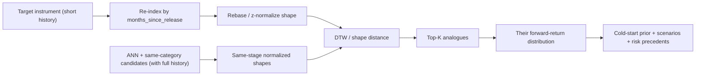

# 09 — Similarity Search & Historical Analogues

"What similar products behaved like this?" is one of the most useful questions in collectible investing, and one of the most defensible ways to reason about a market with little history: **analogy**. This chapter designs two complementary capabilities — **static similarity** (what is this instrument like *right now*?) and **lifecycle-aligned analogues** (which historical products, *at the same age*, followed a similar trajectory — and where did they go next?).

## 1. Two notions of similarity

| Notion | Question | Method | Primary use |
|--------|----------|--------|-------------|
| **Static similarity** | "What products resemble this one today?" | vector embedding + ANN (cosine) | Compare page, discovery, peer group |
| **Trajectory analogue** | "Which products, at this lifecycle stage, moved like this — and what happened next?" | lifecycle alignment + shape/DTW distance on normalized price paths | Cold-start prior, scenario projection, risk precedents |

The second is the quant-interesting one: it converts "we have no history for *this* product" into "but we have history for products that looked just like it at this age."

## 2. Embeddings

- **Feature-space embedding (baseline):** the standardized static + current-state feature vector (category, lifecycle, valuation, momentum, supply, attention — [04](04-feature-engineering.md)) is the embedding. Interpretable and needs no training. Dimensionality controlled via a curated feature subset + optional PCA.
- **Learned embedding (upgrade):** a small **autoencoder** (or metric-learning model) compresses the feature/trajectory space into a dense vector that captures nonlinear structure; trained self-supervised on the panel. Used when it measurably improves neighbor quality.
- **Storage:** `instrument_embeddings.embedding vector(N)` with an **HNSW** index (`vector_cosine_ops`) in pgvector ([03 §10](03-database-design.md#10-similarity--embeddings)); the `method` column records which embedding produced it.

## 3. Approximate nearest-neighbor search

Given a query instrument's embedding, pgvector returns the top-K nearest by cosine similarity. This powers the "most similar products" list, the peer group for cross-sectional normalization ([06](06-investment-score.md)), and candidate generation for analogues. Neighbors are precomputed nightly into `similar_instruments` (with `similarity`, `method`, `rank`) for fast reads, and computed on-demand for ad-hoc queries.

## 4. Clustering (market archetypes)

Over the embedding space we run clustering to discover **market segments/archetypes** (e.g., "modern hyped ETBs," "vintage scarce boxes," "steady Pokémon Center exclusives"):

- **KMeans** for a fixed, interpretable set of segments (with silhouette-guided `k`).
- **HDBSCAN** when we want density-based, variable-count clusters and explicit "noise"/outliers (unique products that belong to no archetype — often the interesting ones).

Clusters label instruments for analytics ([market overview](10-ux-design.md)), power "explore this archetype," and give the risk engine peer context.

## 5. Lifecycle-aligned analogues (the core method)

Raw price series are not comparable across products with different price levels and release dates. We make them comparable by aligning on **lifecycle stage** and **normalizing shape**:

1. **Align by lifecycle clock.** Re-index each series by `months_since_release` instead of calendar date, so month-0 lines up across products.
2. **Normalize shape.** Rebase each trajectory to its value at the alignment point (or z-normalize), removing level/scale so we compare *shape*, not absolute price.
3. **Measure shape distance.** Compare the target's observed early trajectory to each candidate's same-stage trajectory using **Dynamic Time Warping (DTW)** (tolerant of timing shifts) or a simpler shape/correlation distance for speed. Restrict candidates to the ANN neighborhood + same category for tractability and relevance.
4. **Rank analogues.** The closest-shape historical products at the same stage are the analogues; store in `similar_instruments` tagged as `analogue`.
5. **Project forward.** For each analogue, we know what happened *after* the aligned stage. The **distribution of analogues' forward returns** becomes an empirical prior/scenario set: a cold-start prediction prior ([05 §8](05-machine-learning.md#8-cold-start--sparse-instruments)) and an input to Monte Carlo scenarios ([11](11-ai-features.md)).

Example output: *"Prismatic Evolutions ETB (14 months old) most resembles Hidden Fates ETB and Lost Origin ETB at the same age. Those analogues appreciated a median of +18% over the following 6 months (range −4% to +41%)."* — with each analogue clickable.

## 6. Explaining similarity

Similarity must be explainable too ([08](08-explainable-ai.md)). For any match we report a **distance decomposition**: which feature dimensions drive the match (e.g., "matched on lifecycle stage, supply trend, and category; differs on valuation"). For analogues we show the **overlaid, aligned trajectories** so the user sees the shape match, plus the alignment stage and the sample size of forward outcomes.

## 7. Use cases

- **Cold-start forecasting** — new instruments get an analogue-based prior and wider intervals ([05](05-machine-learning.md)).
- **Compare page** — side-by-side of an instrument and its peers/analogues ([10](10-ux-design.md)).
- **Risk precedents** — the risk engine cites analogues ("comparable products dropped 20–35% after reprint") ([07](07-risk-engine.md)).
- **Discovery** — "find undervalued products in the same archetype as my best holding."
- **Monte Carlo scenarios** — analogue forward-return distributions seed empirical scenarios ([11](11-ai-features.md)).

## 8. Pitfalls (and mitigations)

- **Survivorship bias** — if we only track today's survivors, analogues look rosier than reality. Mitigation: retain retired/failed instruments ([04 §2](04-feature-engineering.md#2-leakage-taxonomy-and-mitigations)) and include them as analogues, so "products like this sometimes died" is representable.
- **Small-N analogues** — few matches → unreliable forward distribution. Mitigation: report the sample size, widen uncertainty, and fall back to the pooled model prior.
- **Regime differences** — a 2020 analogue formed under different macro/hype conditions. Mitigation: condition on macro regime where possible and caveat in the narrative.
- **Look-ahead in alignment** — analogue selection must use only the target's data up to `t`. Mitigation: point-in-time discipline, same as features.

Continue to [10 — UX Design](10-ux-design.md).
