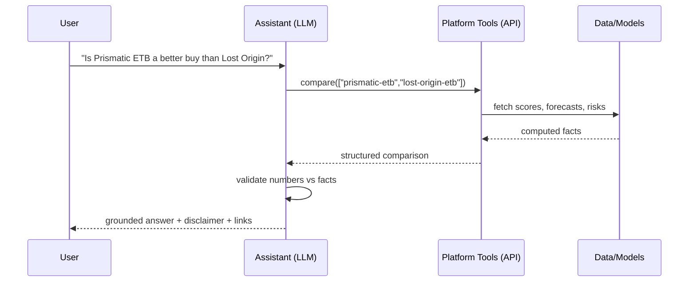

# 11 — AI Features

Beyond the core forecasting engine, PokéQuant layers **applied-AI features** that turn data into decisions: a research assistant, an undervalued scanner, a fair-value estimator, opportunity rankings, Monte Carlo simulations, scenario/what-if analysis, automated portfolio review, a daily market summary, and an alerts engine. Every AI feature obeys the platform rule: **outputs are grounded in computed facts; the LLM phrases, it does not fabricate** ([ADR-0007](adr/0007-explainability-first-class.md)).

## 1. Investment research assistant (chatbot)

A conversational agent that answers questions about instruments, the market, and the user's portfolio — by **calling the platform's own APIs as tools**, never by free-recalling prices.

- **Pattern:** tool-calling / function-calling agent (RAG over structured data, not blobs of text). The LLM plans; the platform's typed endpoints execute; the LLM narrates the returned facts.
- **Tools (each a typed platform capability):** `get_instrument`, `get_forecast(instrument, horizon)`, `get_score(instrument, profile)`, `get_risk(instrument)`, `get_explanation(prediction)`, `find_similar(instrument)` / `get_analogues`, `scan(filters)`, `compare(instruments)`, `monte_carlo(instrument|portfolio, target)`, `scenario(instrument, overrides)`, `portfolio_review(portfolio)`, `get_market_overview()`.
- **Grounding & guardrails:** the system prompt restricts the assistant to facts returned by tools; numbers must originate from tool outputs (validated like [08 §5](08-explainable-ai.md#5-natural-language-generation-with-anti-hallucination-guardrails)); it always appends the not-advice disclaimer; it refuses to invent data it can't fetch.
- **Context-awareness:** the dock knows the current instrument/page and pre-loads relevant tool context.
- **Cost control:** a small model handles routing/tool-selection; a larger model synthesizes; responses cached; conversation state kept lean.

## 2. Fair-value estimator

An instrument's **fair value** blends (a) the model's forecast-implied value, (b) intrinsic **pack EV** from singles ([04 §4.5](04-feature-engineering.md#45-chase-card--expected-value-features)), and (c) analogue-implied value ([09](09-similarity-search.md)), weighted by confidence. The **fair-value gap** `(fair_value − price)/price` drives the valuation sub-score ([06](06-investment-score.md)) and the undervalued scanner. Displayed with its interval, never as false precision.

## 3. Undervalued scanner & opportunity rankings

- **Scanner:** screens the universe by score, fair-value gap, risk ceiling, momentum, liquidity, category, and lifecycle stage; sortable/savable; can spawn an alert or watchlist ([10 §3.6](10-ux-design.md#36-scanner-undervalued--opportunity-finder)).
- **Opportunity rankings:** a curated "top opportunities" list per **profile** (Balanced/Value/Momentum/Conservative), each entry justified by its score breakdown so the ranking is explainable, not a mystery list.

## 4. Monte Carlo simulations

To answer probabilistic questions ("what's the chance it rises 25% in a year?", "what's my downside?"), we simulate forward price paths from the model's **calibrated predictive distribution** ([05 §5](05-machine-learning.md#5-prediction-intervals--calibration)) rather than assuming normality.

- **Per-instrument:** draw many return paths consistent with the quantile/conformal distribution and its volatility term-structure; compute **P(return ≥ target)**, expected value, median, and downside (VaR / expected shortfall). Present as a **fan chart** + probability readouts.
- **Portfolio:** simulate **correlated** instrument paths (using the estimated correlation matrix — [07 §6](07-risk-engine.md#6-portfolio-level-risk)) to get portfolio value distribution, P(target), and portfolio VaR/ES — capturing that same-set holdings co-move.
- **Analogue-seeded scenarios:** empirical forward-return distributions from lifecycle analogues ([09 §5](09-similarity-search.md#5-lifecycle-aligned-analogues-the-core-method)) provide an alternative, non-parametric scenario set shown alongside the model-based one.
- **Grounding:** all probabilities come from the simulation; the assistant/UI reports them verbatim.

## 5. Scenario & "what-if" analysis

Let users (and the assistant) perturb inputs and see the effect, making the model interrogable:

- **Feature overrides:** "if search interest rises 20%," "if supply keeps falling at this rate," "if we enter Q4" → recompute forecast/score/risk with the overridden point-in-time features.
- **Event scenarios:** "if a reprint is announced" → set `reprint_probability → high`, apply the analogue-derived reprint drawdown, and show the revised distribution.
- **Macro scenarios:** "if rates rise / recession" → shift macro features to a stressed regime.
- Each scenario reuses the same inference + explanation path, so results stay explainable and comparable to the base case.

## 6. Automated portfolio review

A one-click (or scheduled) analysis of a portfolio that produces a grounded written review:

- **Exposure & concentration** (category/set/archetype), **diversification**, and **factor exposure** (aggregate reprint/bubble/macro) — [07 §6](07-risk-engine.md#6-portfolio-level-risk).
- **Per-holding verdicts** (score/forecast/risk) and flags (e.g., "Crown Zenith ETB: score decayed to C, momentum negative").
- **Rebalancing ideas** framed as research (e.g., "consider trimming the concentrated modern-ETB exposure; scanner surfaces lower-correlation A-rated alternatives") — always with the disclaimer.

## 7. Daily market summary

A scheduled job composes a market brief from aggregates ([10 §3.11](10-ux-design.md#311-market-overview)): index moves, breadth, notable movers, new opportunities/alerts, and bubble-radar changes. Facts are computed by the analytics module; the LLM writes the prose under guardrails; the brief is cached and delivered in-app/email.

## 8. Alerts engine

Turns signals into timely, edge-triggered notifications ([03 §11](03-database-design.md#11-users-portfolio-engagement)).

- **Alert kinds:** `price_above/below`, `pct_change`, `score_above`, **undervalued** (fair-value gap crosses threshold), **bubble** warning ([07](07-risk-engine.md)), oversupply/liquidity warnings, forecast-crosses-threshold, and custom filter alerts (from a saved scanner screen).
- **Evaluation:** a scheduled worker loads active rules + latest signals and fires on **edge crossings** (not every tick), respecting a per-rule **cooldown** to avoid spam ([01 §7.4](01-system-architecture.md#74-alert-evaluation)).
- **Channels:** in-app, email, webhook (push later); each firing records an `alert_event` and a `notification`.
- **Explainable:** every alert states *why* it fired, with a link to the product page's `WhyPanel`.

## 9. Guardrails, cost, and evaluation (cross-cutting)

- **Grounding everywhere:** LLM features consume the same structured fact sets the UI uses; numeric outputs are validated against those facts or discarded ([08 §5](08-explainable-ai.md#5-natural-language-generation-with-anti-hallucination-guardrails)).
- **Cost discipline:** small models for routing, large for synthesis; aggressive caching; scale-to-zero for the assistant/inference in the cost-optimized track ([01 §11](01-system-architecture.md#11-cost-optimization)).
- **Safety:** persistent research-not-advice disclaimers; no execution/brokerage ([00 §7](00-overview.md#7-scope-and-non-goals)); refusal when data is unavailable rather than guessing.
- **Evaluation:** assistant answers are checked for grounding (do cited numbers exist in tool outputs?); Monte Carlo probabilities are back-tested for calibration; scenario outputs are sanity-checked for monotonicity (more supply → lower value).

Continue to [12 — Roadmap](12-roadmap.md).
