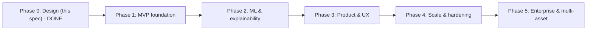

# 12 — Roadmap

Delivery is phased so each phase is independently valuable, testable, and demoable, and so we build the *hard, differentiating* parts (data pipeline, honest ML, explainability) on a solid foundation rather than bolting them on. Development proceeds **one milestone at a time with approval gates** between phases.

Effort estimates assume a single engineer working part-time and are **rough planning ranges**, not commitments. Complexity/difficulty are relative (Low/Med/High/Very High).

## Phase overview

The critical path is **data first** (nothing works without a trustworthy pipeline + snapshots + synthetic backfill), then **ML + explainability** (the differentiator), then **product surfaces**, then **scale**, then **prove extensibility** with a second asset class.

---

## Phase 0 — Design (complete)

The specification in this `docs/` directory: architecture, data sources, DB, features, ML, scoring, risk, XAI, similarity, UX, AI features, standards, and ADRs.

- **Deliverables:** this spec + ADRs. **Complexity:** Med. **Time:** done. **Exit criteria:** design approved.

---

## Phase 1 — MVP foundation

**Goal:** a running, typed, observable skeleton that ingests permitted data, builds snapshots, generates synthetic history, and shows a product page with real price history and a naive/baseline forecast. Proves the whole spine end-to-end.

- **Deliverables:**
  - Monorepo scaffold, Docker Compose, CI (lint/type/test), config/secrets, structured logging ([13](13-engineering-standards.md)).
  - Postgres + Timescale + pgvector; Alembic migrations; core schema ([03](03-database-design.md)); seed catalog (PokemonTCG.io sets + curated sealed list).
  - Provider adapters: **PokemonTCG.io**, **eBay Browse**, **FRED** (+ rate-limit orchestrator) behind the provider ports ([ADR-0006](adr/0006-provider-plugin-interface.md)).
  - Daily ingestion + snapshot pipeline (Prefect); `provider_runs` observability.
  - **Synthetic historical generator** ([ADR-0005](adr/0005-synthetic-historical-backfill.md)).
  - Baseline models: naive/seasonal-naive + **LightGBM** point forecast; walk-forward eval harness.
  - FastAPI: catalog + price + forecast read endpoints; Next.js: catalog, product page with price chart + baseline forecast.
- **Complexity:** High · **Difficulty:** Med-High · **Time:** ~5–8 weeks.
- **Major risks:** data-source integration friction (auth, rate limits, instrument matching); scope creep. **Mitigations:** start with the 3 cleanest sources; recorded fixtures for adapter tests; strict Phase-1 scope.
- **Exit criteria:** one-command local bring-up; daily pipeline populates snapshots; product page renders real history + a baseline forecast that **beats naive** on the eval harness (on synthetic + any real data); green CI.

---

## Phase 2 — Machine learning & explainability

**Goal:** the differentiator — a real forecasting system with calibrated intervals, SHAP explanations, the Investment Score, and the Risk Engine.

- **Deliverables:**
  - Full **feature pipeline** + versioned feature store ([04](04-feature-engineering.md)).
  - Model zoo (LightGBM quantiles primary; Prophet decomposition; TFT when data-ready) + **Optuna** HPO + **MLflow** tracking/registry + champion/challenger promotion ([05](05-machine-learning.md)).
  - **Quantile + conformal** prediction intervals with calibration monitoring ([ADR-0010](adr/0010-quantile-prediction-intervals.md)).
  - **SHAP** attributions + facts-first NL explanations with guardrails ([08](08-explainable-ai.md)).
  - **Investment Score** + components ([06](06-investment-score.md)); **Risk Engine** + factors ([07](07-risk-engine.md)).
  - Batch inference; predictions/explanations/scores persisted; product page `WhyPanel`.
- **Complexity:** Very High · **Difficulty:** High · **Time:** ~7–11 weeks.
- **Major risks:** leakage producing fake accuracy; miscalibration; thin real history. **Mitigations:** purge/embargo walk-forward, calibration gates, synthetic-labeled metrics, analogue-based cold start.
- **Exit criteria:** interval coverage ≈ nominal on holdout; model beats naive on directional accuracy; every prediction has a stored, faithful explanation; score is monotonic vs realized outcomes on backtest.

---

## Phase 3 — Product & UX

**Goal:** a usable product: accounts, portfolio, watchlists, alerts, similarity/analogues, the AI assistant, Monte Carlo, and the full UI.

- **Deliverables:**
  - **Auth/RBAC**, API keys ([01 §8](01-system-architecture.md#8-cross-cutting-concerns)); users.
  - **Portfolio** (transactions → holdings, P&L), **watchlists**, **alerts** engine + channels ([11 §8](11-ai-features.md#8-alerts-engine)).
  - **Similarity + analogues** (pgvector, clustering, DTW alignment) ([09](09-similarity-search.md)).
  - **AI assistant** (tool-calling, grounded), **Monte Carlo**, **scenario/what-if**, **portfolio review**, **daily summary** ([11](11-ai-features.md)).
  - Full UI: dashboard, scanner, compare, market overview, risk, predictions, settings, admin ([10](10-ux-design.md)).
  - Observability stack (metrics/logs/traces/Sentry); E2E tests.
- **Complexity:** High · **Difficulty:** Med-High · **Time:** ~8–12 weeks.
- **Major risks:** LLM grounding/hallucination; UX complexity; cost. **Mitigations:** fact-validation gate, caching, small/large model split, progressive disclosure UX.
- **Exit criteria:** a user can research → watch → simulate → get alerts; assistant answers are grounded; scanner + Monte Carlo demonstrably work; p95 latency budgets met.

---

## Phase 4 — Scale & hardening

**Goal:** production-grade reliability, performance, and MLOps.

- **Deliverables:**
  - Caching/perf tuning; Timescale continuous aggregates/compression/retention; read replicas as needed ([01 §9](01-system-architecture.md#9-scalability-strategy)).
  - Prefect productionization; **drift monitoring** (Evidently) + drift-triggered retraining ([05 §9](05-machine-learning.md#9-model-lifecycle--registry)).
  - Track B infra: **Kubernetes/Helm + Terraform**, autoscaling, blue/green/canary ([01 §10](01-system-architecture.md#10-deployment-strategy-two-tracks)).
  - Security hardening (scanning, SBOM, secret rotation), backups/DR, cost dashboards.
  - Load/perf testing; SLOs + alerting.
- **Complexity:** High · **Difficulty:** Med-High · **Time:** ~6–9 weeks.
- **Major risks:** infra complexity/cost; retraining regressions. **Mitigations:** stay on Track A until justified; promotion gates + shadow eval; cost budgets.
- **Exit criteria:** meets SLOs under load; automated retraining with gates; reproducible IaC deploys; monitored, alerting, backed up.

---

## Phase 5 — Enterprise & multi-asset

**Goal:** prove the platform thesis — add a **second asset class** as a plugin with minimal core change — plus advanced tooling.

- **Deliverables:**
  - A second **asset-class plugin** (e.g., `mtg_sealed` or `sports_cards`): its providers, attribute schema, and features — **no forecasting/score/risk/UI rewrites** ([ADR-0004](adr/0004-generic-asset-model-and-plugin-registry.md)).
  - Advanced backtesting/scenario studio; richer admin; team/roles; public API + docs; billing (if productized).
- **Complexity:** High · **Difficulty:** Med-High · **Time:** ~6–10 weeks (largely validating extensibility).
- **Major risks:** hidden Pokémon-specific assumptions leaking into the core. **Mitigations:** the plugin work itself is the test; fix leaks by pushing specifics into the plugin.
- **Exit criteria:** the second asset class runs end-to-end (ingest → forecast → score → risk → UI) reusing the core; onboarding a class is a contained, documented effort.

---

## Cumulative view

| Phase | Focus | Complexity | Rough time (part-time) | Headline deliverable |
|-------|-------|-----------|------------------------|----------------------|
| 1 | MVP foundation | High | 5–8 wks | End-to-end spine + baseline forecast |
| 2 | ML & XAI | Very High | 7–11 wks | Calibrated, explained forecasts + score + risk |
| 3 | Product & UX | High | 8–12 wks | Full app: portfolio, assistant, Monte Carlo, alerts |
| 4 | Scale & hardening | High | 6–9 wks | Production reliability + MLOps |
| 5 | Enterprise & multi-asset | High | 6–10 wks | Second asset class proves extensibility |

**Interview-readiness checkpoints:** the project is already discussable after Phase 1 (data engineering + architecture), compelling after Phase 2 (honest ML + explainability + uncertainty), and a strong portfolio piece after Phase 3 (a real product). Phase 5 is the "this is a platform, not a project" mic-drop.

Continue to [13 — Engineering Standards](13-engineering-standards.md).
